# Cadence

**An AI social media studio: Gemini writes the captions, you pick one and a time, Cadence saves it, syncs the draft to your Google Drive, and emails you a reminder before it is due.** (Cadence does not post to the social platforms itself: you publish the caption yourself when the reminder arrives.)

Built for the VSpark 2026 Web Development Competition (COMSATS University Islamabad, Vehari Campus).

| | |
| --- | --- |
| **Live URL** | **[eventdesk-self.vercel.app](https://eventdesk-self.vercel.app)** https://eventdesk-self.vercel.app (health check: [/api/health](https://eventdesk-self.vercel.app/api/health)). The `eventdesk` name is left over from the starter template this project was converted from |
| **Demo account** | Sign up with any email (email confirmation is off), then open the studio at `/dashboard` |
| **Repository** | [github.com/zainashrafofficial/eventdesk](https://github.com/zainashrafofficial/eventdesk) |
| **Stack** | Next.js 16 (App Router, Turbopack) · React 19 · TypeScript strict · Supabase (Postgres, Auth, RLS, pg_cron) · Tailwind CSS v4 · Zod · Google Gemini API · Google Drive API (OAuth 2.0) · Resend |

---

## Contents

1. [The brief, and how Cadence answers it](#1-the-brief-and-how-cadence-answers-it)
2. [Features mapped to the judging rubric](#2-features-mapped-to-the-judging-rubric)
3. [Architecture overview](#3-architecture-overview)
4. [Security and rate limiting](#4-security-and-rate-limiting)
5. [Environment variables and API keys](#5-environment-variables-and-api-keys)
6. [Setup guide (step by step)](#6-setup-guide-step-by-step)
7. [Deployment (Vercel)](#7-deployment-vercel)
8. [Screenshots: each pipeline, in order](#8-screenshots-each-pipeline-in-order)
9. [Testing](#9-testing)
10. [Project structure](#10-project-structure)

---

## 1. The brief, and how Cadence answers it

| # | Brief requirement | Cadence |
| --- | --- | --- |
| 1 | AI generates caption options with hashtags | Describe the post, pick a platform (Instagram, X, LinkedIn, Facebook, TikTok), tone and count → **Gemini** returns **2–3 options** as zod-validated structured JSON (caption + up to 10 cleaned, de-duplicated hashtags). The prompt asks Gemini to respect the platform's character limit; the limit itself is enforced when you save (and by the composer's live counter) |
| 2 | Pick one, pick a time, save, sync to cloud | Select an option, edit it if you like, choose date/time + task notes → **Save draft** or **Schedule post**. The post is written to Postgres and synced as a Google Doc into a **"Cadence Drafts"** folder in the user's own **Google Drive** |
| 3 | Feed of saved / scheduled posts with edit + delete | The studio feed lists every post (scheduled soonest first, drafts last) with platform, time, Drive and email status (a scheduled post whose time has passed is labelled *Published* in the browser; the server never marks posts published and nothing is posted to the platforms); **Edit** changes caption/hashtags/time (and re-syncs the Doc); **Delete** asks for confirmation and removes the Doc too |
| 4 | Automated email per scheduled post + customisable notifications | Scheduling sends an **immediate confirmation email** (Resend); the **Supabase pg_cron job `cadence-reminders`** runs every minute and sends a **reminder N minutes before** each post. Resend's free mode (no verified domain) only delivers to the Resend account owner's email. Users set the address, on/off, reminder lead time, subject prefix, whether to include the caption, and time zone. Every email is logged in an activity panel |
| 5 | Deployed | Live on Vercel (link above), health endpoint, env-driven configuration |

## 2. Features mapped to the judging rubric

| Rubric criterion | What Cadence does | Where in the code |
| --- | --- | --- |
| **UI/UX & Responsiveness** | One calm, Apple-style studio page: generator → options → composer → feed, side column for Drive / notifications / email activity. Light + dark, glass surfaces, skeletons, toasts, empty states, inline validation, keyboard + screen-reader friendly, works from 390 px phones up | `src/components/studio/*`, `src/components/ui/*`, `src/app/globals.css` |
| **Authentication** | Email sign-up (name, email, password + confirm), sign-in, sign-out, HTTP-only cookie sessions refreshed on every request, `?next=` return after login, protected pages, Server Actions and Route Handlers | `src/lib/actions/auth.ts`, `src/proxy.ts`, `src/lib/auth/dal.ts` |
| **Database & CRUD** | Posts: **Create** (draft or scheduled), **Read** (feed + stats), **Update** (edit dialog), **Delete** (confirm dialog). Notification settings: upsert. Email log: read. Postgres `CHECK` constraints, triggers, indexes, RLS on every table | `src/lib/data/posts.ts`, `src/lib/actions/posts.ts`, `src/lib/actions/notifications.ts`, `supabase/migrations/` |
| **Cloud Storage** | **Google Drive**: OAuth 2.0 connect (scope `drive.file`, so Cadence only sees files it created), each post becomes a Google Doc in "Cadence Drafts", updated on edit, removed on delete, manual "Sync now" / "Sync all", disconnect | `src/lib/services/google-drive.ts`, `src/app/api/drive/*`, `src/lib/actions/drive.ts`, `src/components/studio/drive-status.tsx` |
| **External APIs** | **Google Gemini** (default `gemini-flash-lite-latest`, falling back to `gemini-flash-latest` with thinking disabled; structured JSON output + zod validation), **Google Drive API** (OAuth + Docs), **Resend** (transactional email). Timeouts, typed errors, rate limits, and every one degrades gracefully when its key is missing | `src/lib/services/gemini.ts`, `src/app/api/generate/route.ts`, `src/lib/services/email.ts`, `src/app/api/cron/notify/route.ts` |
| **Deployment** | Vercel, `/api/health`, all secrets in Vercel env vars, pg_cron calls the deployed URL | [section 7](#7-deployment-vercel) |
| **Code Quality & Architecture** | Layered: proxy → Data Access Layer → data (reads) / actions (writes) / services (3rd-party) → validation. The server runs the full zod schema on every write; the auth forms run the same schema in the browser, while the composer and edit dialog use lightweight checks with the same limits. TypeScript strict with **no `any`**. Typed `ActionResult` everywhere | [section 10](#10-project-structure) |
| **Documentation** | This README, `.env.example` (every variable commented), setup + Google Cloud steps, architecture + ER diagrams, screenshots, `docs/DEFENSE.md` | you're reading it |
| **Demo** | Scripted 3-minute walk-through + judge Q&A in [`docs/DEFENSE.md`](docs/DEFENSE.md); `npm run test:e2e` replays the whole flow and regenerates the screenshots | `docs/DEFENSE.md`, `scripts/screenshots.mjs` |

---

## 3. Architecture overview

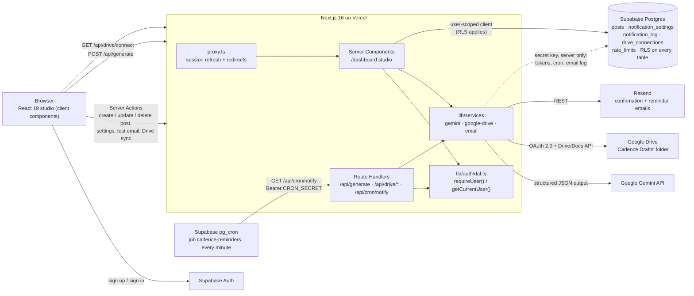

**Request lifecycle**

1. Every request passes through `src/proxy.ts` (Next.js 16's replacement for middleware). It refreshes the Supabase session cookie, redirects signed-out users away from `/dashboard` to `/login?next=...`, and signed-in users away from `/login` and `/signup`.
2. `/dashboard` is a **Server Component**. It calls `getStudioData()` (`src/lib/data/posts.ts`), which calls `requireUser()` and loads posts, Drive status, notification settings, the email log and stats with the **user-scoped** Supabase client, so Row Level Security applies to every query.
3. **Generate**: the client posts `{ prompt, platform, tone, count }` to `/api/generate`. The route checks the session, validates with zod, applies the rate limit, and calls Gemini with a JSON response schema. The default model is `gemini-flash-lite-latest`; if it is missing, overloaded or times out, the call falls back to `gemini-flash-latest` with thinking disabled (`thinkingBudget: 0`). The output is parsed and validated with zod, then sanitised (captions trimmed, hashtags cleaned and de-duplicated to at most 10, option count capped) before it reaches the browser. The platform character limit is enforced when the post is saved (`platformLengthError()` in `src/lib/validation/post.ts`).
4. **Save / schedule** is a **Server Action** (`createPost`): validate → rate limit → insert → sync to Google Drive (if connected) → send the confirmation email (if scheduled) → `revalidatePath("/dashboard")`. Drive or email failures never lose the post: they are recorded on the row (`drive_sync_error`, `notification_log`) and shown in the UI.
5. **Reminders**: the Supabase **pg_cron** job `cadence-reminders` calls `GET /api/cron/notify` every minute with `Authorization: Bearer <CRON_SECRET>`. The handler compares the secret in constant time, finds scheduled posts whose reminder time has arrived (`scheduled_at - remind_before_minutes <= now()` and `reminder_sent_at is null`), emails them, and stamps `reminder_sent_at` so each reminder goes out exactly once.

**Data model**

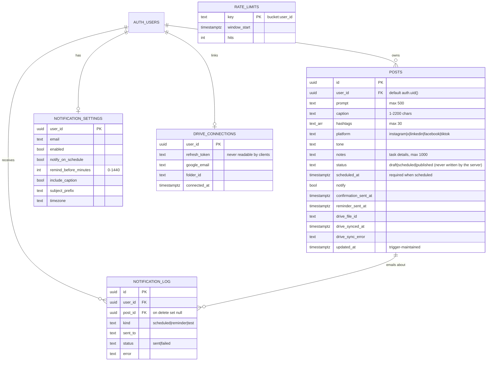

---

## 4. Security and rate limiting

- **Three layers of route protection**: `proxy.ts` redirects; every page / Server Action / Route Handler calls `requireUser()` / `getCurrentUser()` (JWT verified with `getClaims()`); Postgres **Row Level Security** enforces ownership even if the app layer were bypassed.
- **RLS on every table**: `posts` and `notification_settings` are owner-only (`user_id = auth.uid()` for using *and* with check); `notification_log` is owner read-only (only the server writes it); `drive_connections` is owner read/delete; `rate_limits` has **no grants at all**.
- **OAuth refresh tokens are hidden at the column level**: clients are granted `select (user_id, google_email, folder_id, connected_at)` only, so `select refresh_token` (or `select *`) from the browser fails with *permission denied*. Tokens are written and read only by the server with the secret key (`src/lib/supabase/admin.ts`, `server-only`).
- **CSRF protection on OAuth**: `/api/drive/connect` sets a random `state` in an HTTP-only cookie; `/api/drive/callback` rejects the response unless it matches. Scope is `drive.file`: Cadence can only touch files it created.
- **Rate limiter bound to the caller**: `check_rate_limit()` is a `SECURITY DEFINER` function that builds its key from `auth.uid()` inside the database, so a user can't spend or reset someone else's quota; anonymous callers can't execute it. It's a fixed window shared by every serverless instance (no in-memory state). It deliberately **fails open**: if the RPC itself errors, the request is allowed and the error is logged (`failOpen()` in `src/lib/rate-limit.ts`).
- **Cron endpoint**: requires `Authorization: Bearer <CRON_SECRET>`, compared in **constant time** (`timingSafeEqual`); anything else gets 401.
- **Validation everywhere**: the server always runs the full zod schema (`postSchema` / `postUpdateSchema`, auth and notification schemas); the auth forms run the same zod schema in the browser, the composer and edit dialog use lightweight hand-written checks with the same limits; Gemini output re-validated with zod; DB `CHECK` constraints as the last line. TypeScript strict, **no `any`**.
- **No secrets in the browser or repo**: only `NEXT_PUBLIC_SUPABASE_URL` / publishable key are public; Gemini, Google, Resend, Supabase secret and cron secret are server-only env vars. `.env*` is git-ignored except `.env.example`.
- **Safe redirects** (`?next=` only accepts same-origin paths), **security headers** (`X-Content-Type-Options`, `X-Frame-Options`, `Referrer-Policy`, `Permissions-Policy`), and **no account enumeration** on sign-in.

**Rate limits** (per user, enforced in Postgres via `check_rate_limit`; exceeding one returns HTTP 429 with `Retry-After` from `/api/generate`, or a friendly "try again in N s" error from Server Actions)

| Bucket | Limit | Applies to |
| --- | --- | --- |
| `generate` | **10 / minute** | `POST /api/generate` (Gemini calls) |
| `mutate` | **30 / minute** | create / update / delete post, save notification settings |
| `drive_sync` | **30 / minute** | "Sync now" / "Sync all" (its own bucket, not counted in `mutate`) |
| `email` | **5 / 5 minutes** | "Send test email" |

---

## 5. Environment variables and API keys

Copy `.env.example` to `.env.local` and fill in:

| Variable | Required | Where to get it | Purpose |
| --- | --- | --- | --- |
| `NEXT_PUBLIC_SITE_URL` | yes | `http://localhost:3000` locally, `https://your-app.vercel.app` in production | Auth email redirects and the Google OAuth redirect URI (`{SITE}/api/drive/callback`) |
| `NEXT_PUBLIC_SUPABASE_URL` | yes | Supabase → Project Settings → API → Project URL | Supabase endpoint |
| `NEXT_PUBLIC_SUPABASE_PUBLISHABLE_KEY` | yes | Supabase → Project Settings → API Keys → **Publishable key** (`sb_publishable_...`) | Public client key; safe in the browser because RLS protects all data |
| `SUPABASE_SECRET_KEY` | for Drive + email | Supabase → API Keys → **Secret key** (`sb_secret_...`) | **Server only.** Stores/reads Drive refresh tokens, runs the reminder cron, writes the email log |
| `GEMINI_API_KEY` | for AI | [aistudio.google.com/apikey](https://aistudio.google.com/apikey) | Caption generation |
| `GEMINI_MODEL` | no | default `gemini-flash-lite-latest` (falls back to `gemini-flash-latest`, thinking disabled) | Override the first model tried |
| `GOOGLE_CLIENT_ID` / `GOOGLE_CLIENT_SECRET` | for Drive | Google Cloud → OAuth client ID (Web), see [step 6](#6-setup-guide-step-by-step) | Google Drive OAuth |
| `RESEND_API_KEY` | for email | [resend.com](https://resend.com) → API Keys | Confirmation, reminder and test emails. Resend's free mode (no verified domain) only delivers to the Resend account owner's email |
| `EMAIL_FROM` | no | default `Cadence <onboarding@resend.dev>` | Sender (use a verified domain in production) |
| `CRON_SECRET` | for reminders | any long random string (`openssl rand -hex 32`) | Shared secret between pg_cron and `/api/cron/notify` |

**API keys needed**

| External service | Key needed? | Free tier | Without it |
| --- | --- | --- | --- |
| Supabase (Auth, Postgres, pg_cron) | URL + publishable key (+ secret key) | Yes | App can't run |
| Google Gemini API | `GEMINI_API_KEY` | Yes (AI Studio) | Generator shows "AI isn't configured"; you can still write captions by hand |
| Google Drive API | OAuth client ID + secret | Yes | Drive card shows "not configured"; posts still save |
| Resend | `RESEND_API_KEY` | Yes (100 emails/day) | Emails are skipped and logged as not configured |

---

## 6. Setup guide (step by step)

### Prerequisites
- Node.js **20.9+** and npm
- Free accounts: [Supabase](https://supabase.com), [Google AI Studio](https://aistudio.google.com), [Google Cloud](https://console.cloud.google.com), [Resend](https://resend.com)

### 1. Install
```bash
npm install
cp .env.example .env.local        # Windows PowerShell: Copy-Item .env.example .env.local
```

### 2. Supabase
1. Create a project at supabase.com → New project. Copy the URL, publishable key and secret key into `.env.local`.
2. **SQL Editor** → New query → run the migrations **in order**:
   1. `supabase/migrations/20261118000001_init.sql` (left over from the EventDesk starter: events, attachments, a storage bucket; Cadence does not use it)
   2. `supabase/migrations/20261118000002_cadence.sql` (all of Cadence's schema: posts, notification settings/log, Drive connections, rate limiter, RLS + grants)
3. **Reminders**: open `supabase/cron.sql`, replace `REPLACE_WITH_CRON_SECRET` (and the URL, if your deployment differs) with your values, and run it in the SQL Editor. It enables **pg_cron** + **pg_net** and schedules the `cadence-reminders` job that calls `GET {SITE}/api/cron/notify` every minute. Re-running it is safe; the file also lists queries to inspect runs and to unschedule.
4. **Auth**: Authentication → Sign In / Providers → Email → turn **Confirm email OFF** (users go straight to the studio; the app also handles confirmation if you turn it on). Authentication → URL Configuration → Site URL = your site URL; add `http://localhost:3000/**` and `https://your-app.vercel.app/**` to Redirect URLs.

### 3. Google Gemini
[aistudio.google.com/apikey](https://aistudio.google.com/apikey) → **Create API key** → `GEMINI_API_KEY`.

### 4. Google Drive (OAuth)
1. [console.cloud.google.com](https://console.cloud.google.com) → **Create project** (e.g. "Cadence").
2. APIs & Services → **Library** → search **Google Drive API** → **Enable**.
3. APIs & Services → **OAuth consent screen** → User type **External** → app name, support email → scopes can stay default (the app requests `drive.file`, `openid`, `email`) → **Test users: add your own Google account** (and the judges' if needed) → Save.
4. APIs & Services → **Credentials** → **Create credentials → OAuth client ID** → Application type **Web application** → **Authorised redirect URIs**:
   - `http://localhost:3000/api/drive/callback`
   - `https://your-app.vercel.app/api/drive/callback`
5. Copy the **Client ID** and **Client secret** into `GOOGLE_CLIENT_ID` / `GOOGLE_CLIENT_SECRET`.

> While the consent screen is in *Testing*, only listed test users can connect, and Google shows an "unverified app" notice: click **Continue**.

### 5. Resend
[resend.com](https://resend.com) → API Keys → **Create** → `RESEND_API_KEY`. In Resend's free mode (no verified domain) it only delivers to the Resend account owner's email, so set your notification email to that address while testing.

### 6. Cron secret and run
```bash
# put any long random string in CRON_SECRET (same value as in supabase/cron.sql)
npm run dev                       # http://localhost:3000
```
Open the app → **Get started** → create an account → describe a post → **Generate captions** → pick one → **Schedule post**. Connect Drive from the Drive card.

> pg_cron runs in Supabase's cloud, so it can only reach a **public** URL. Locally you can trigger reminders by hand:
> `curl -H "Authorization: Bearer $CRON_SECRET" http://localhost:3000/api/cron/notify`

### Useful scripts

| Command | What it does |
| --- | --- |
| `npm run dev` | Development server |
| `npm run build` / `npm start` | Production build / serve |
| `npm run typecheck` · `npm run lint` · `npm run check` | TypeScript, ESLint, both |
| `npm run test:security` | Proves RLS, column grants and the rate limiter at the database level (24 checks) |
| `npm run test:e2e` | Drives the real app in Chrome through every pipeline and saves screenshots |

---

## 7. Deployment (Vercel)

1. Push the repository to GitHub (public).
2. [vercel.com/new](https://vercel.com/new) → **Import** the repo. Framework preset: **Next.js** (auto-detected).
3. **Environment Variables** → add every variable from [section 5](#5-environment-variables-and-api-keys) (`NEXT_PUBLIC_SITE_URL` = your Vercel URL) → **Deploy**.
4. Supabase → Authentication → URL Configuration: Site URL = the Vercel URL; add `https://your-app.vercel.app/**` to Redirect URLs.
5. Google Cloud → Credentials → your OAuth client: make sure `https://your-app.vercel.app/api/drive/callback` is listed.
6. Run `supabase/cron.sql` with the **production** URL and the same `CRON_SECRET` as in Vercel.
7. Verify: `https://your-app.vercel.app/api/health` returns `{"status":"ok","supabaseConfigured":true,...}`, then:
   ```bash
   BASE_URL=https://your-app.vercel.app npm run test:e2e
   # PowerShell: $env:BASE_URL="https://your-app.vercel.app"; npm run test:e2e
   ```

> `NEXT_PUBLIC_*` variables are baked in at build time. If you change one in Vercel, **redeploy**.

**Region:** `vercel.json` pins serverless functions to `bom1` (Mumbai), close to users in Pakistan; ideally the Supabase project sits in `ap-south-1` too.

**Deployment protection:** the production domain must be public for judges (Vercel → Settings → Deployment Protection → *Vercel Authentication* off for production).

---

## 8. Screenshots: each pipeline, in order

Generated by `npm run test:e2e`, which also asserts that each step works.

### Landing page
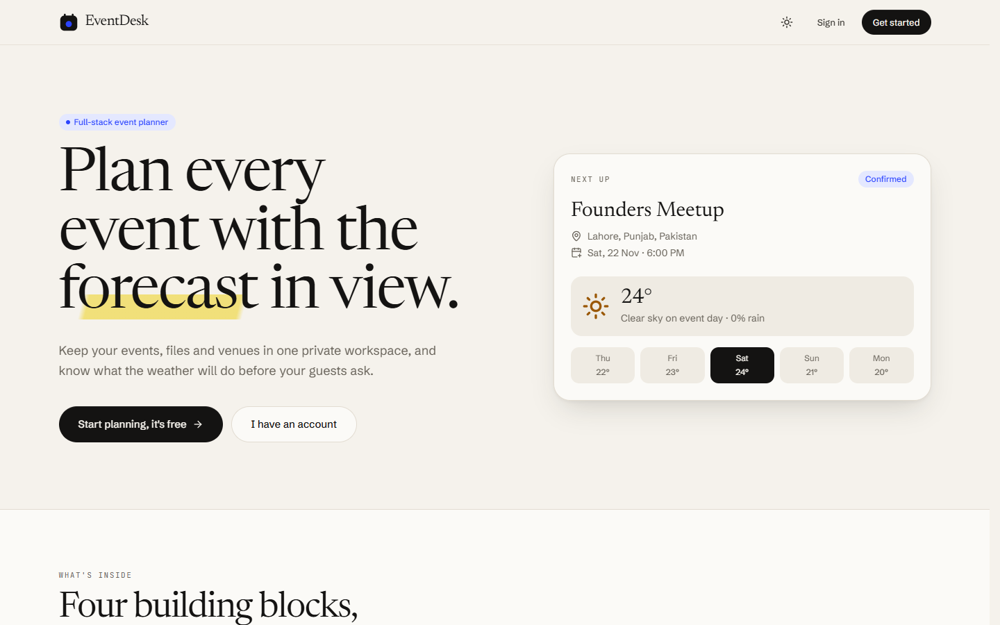

### Auth pipeline
| Route protection: `/dashboard` while signed out → `/login?next=...` | Sign-up validation (client + server) |
| --- | --- |
| 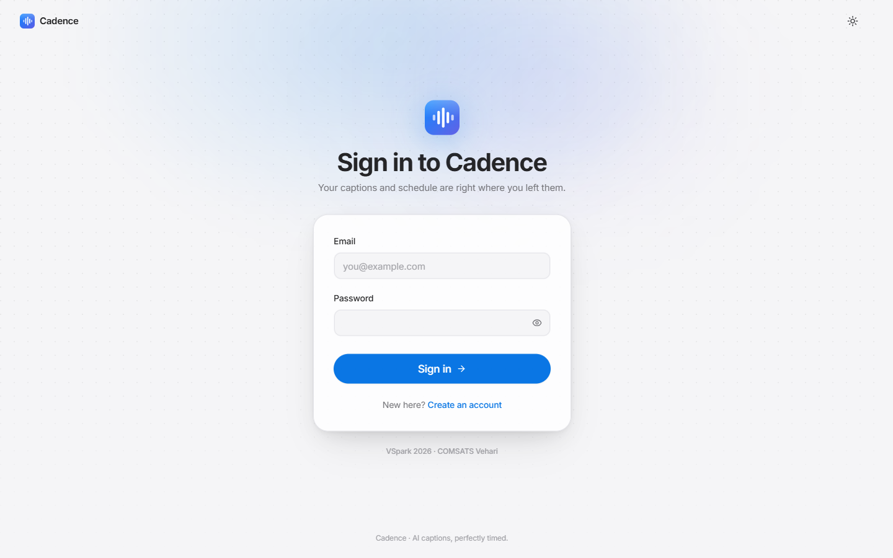 | 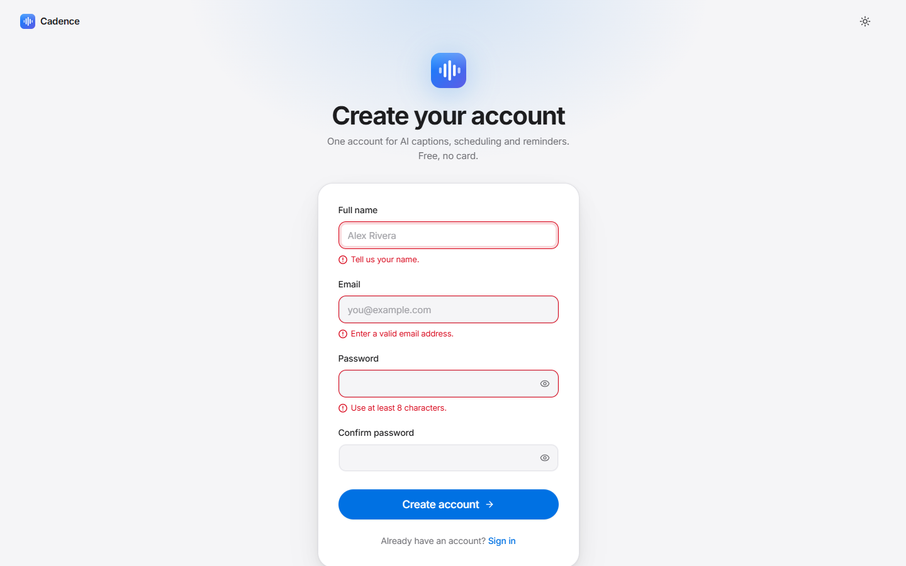 |

| Sign-up form | First sign-in: empty studio |
| --- | --- |
| 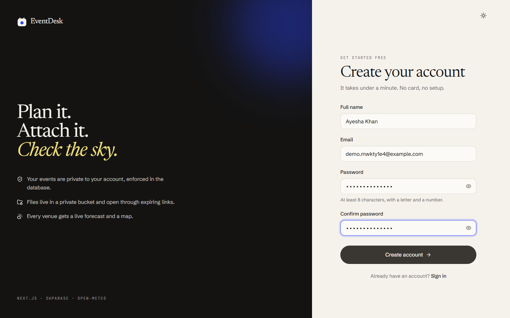 | 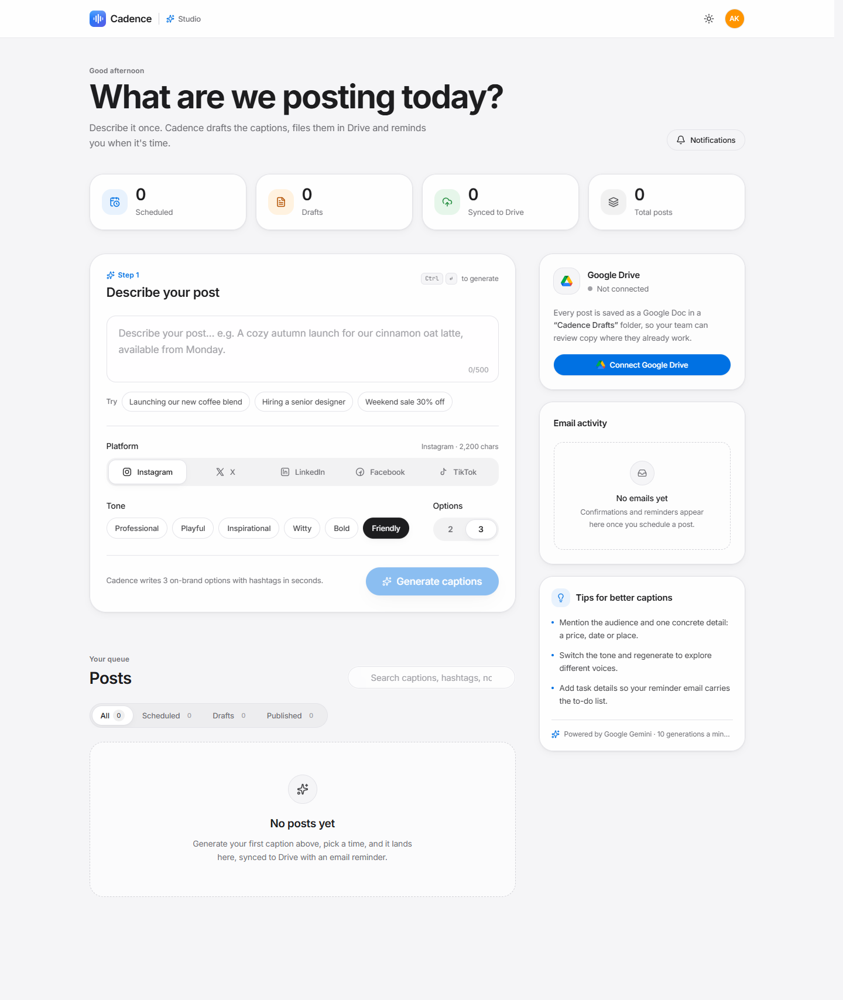 |

### Generate (Gemini)
| Prompt + platform | Caption options with hashtags |
| --- | --- |
| 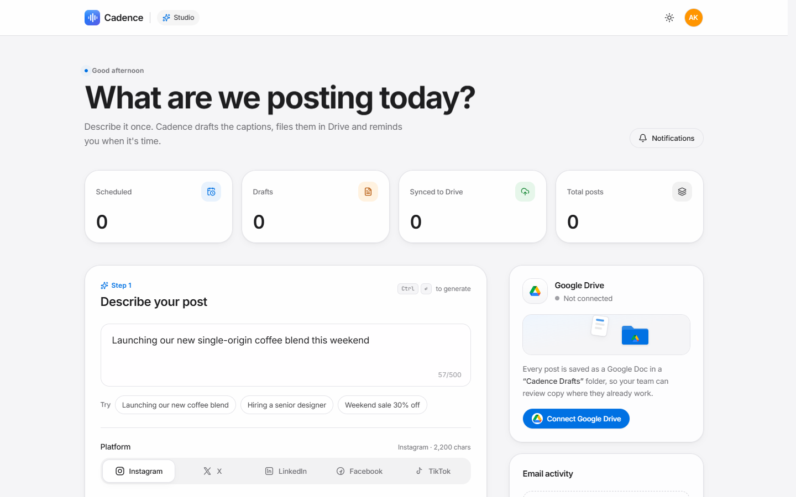 | 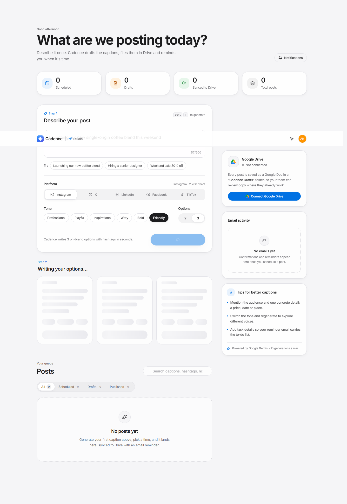 |

### Schedule (database + Google Drive + email)
| Pick a time and task notes | Feed of saved and scheduled posts |
| --- | --- |
| 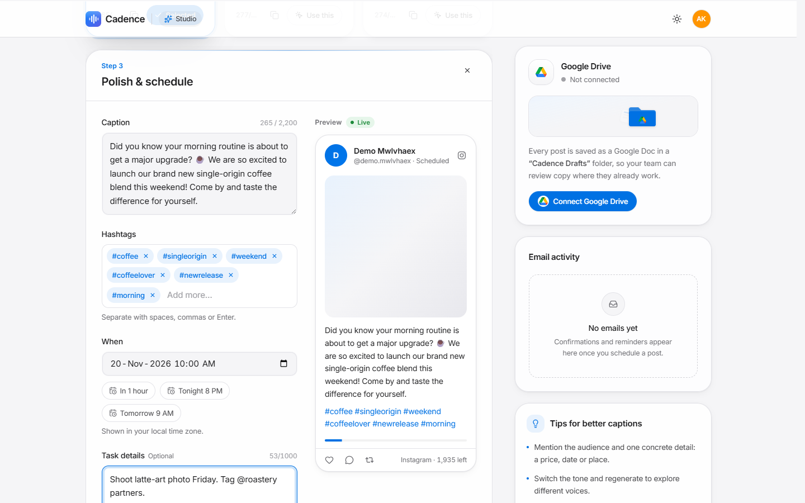 | 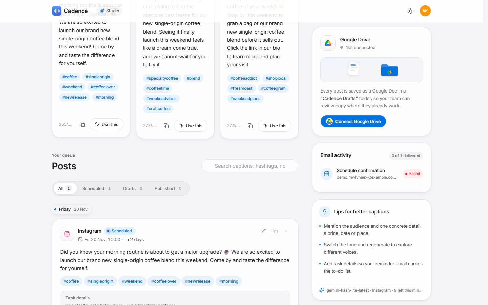 |

### Update, notifications, delete
| Edit caption | Notification settings | Delete confirmation |
| --- | --- | --- |
| 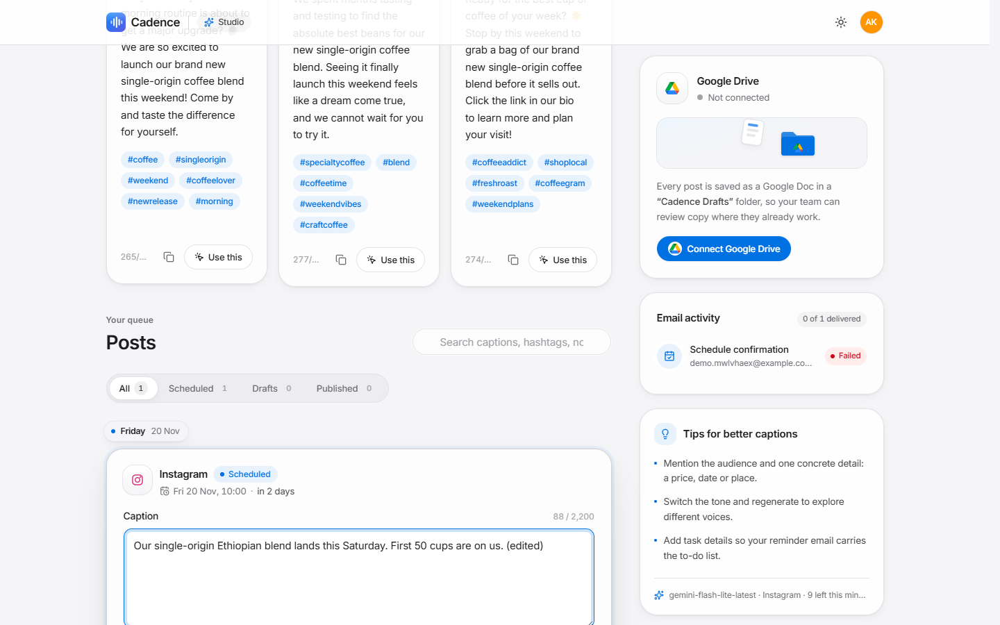 | 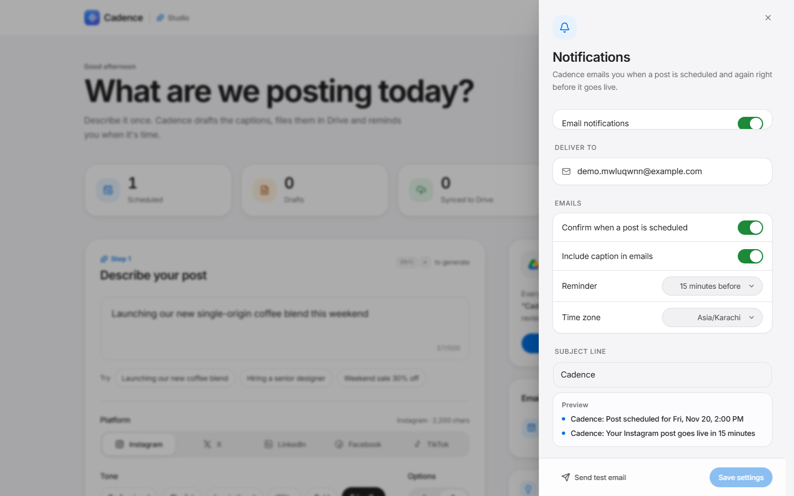 | 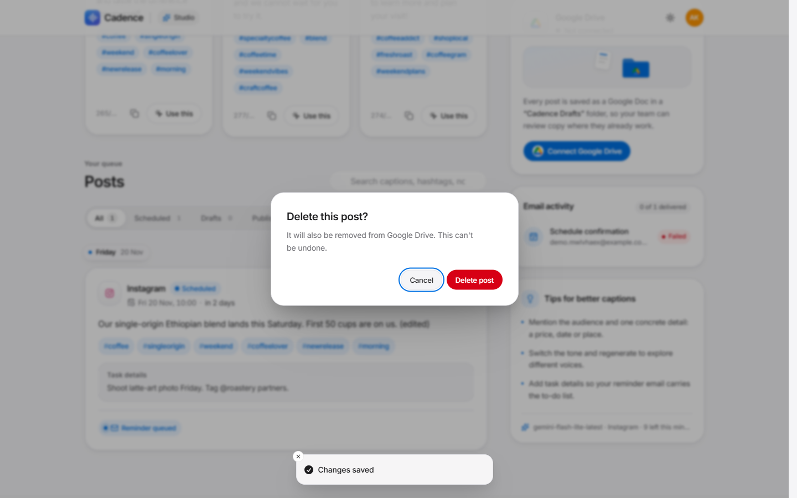 |

### Responsive (mobile)
| Studio on mobile | Feed on mobile |
| --- | --- |
| 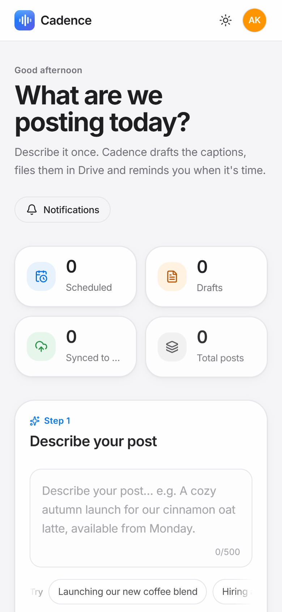 | 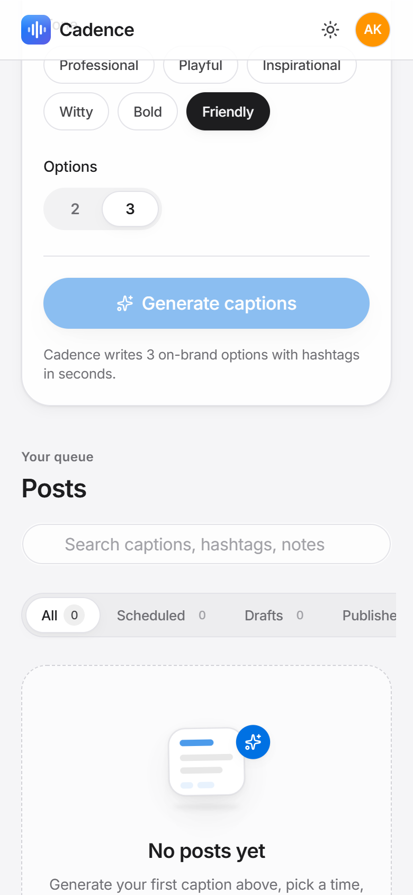 |

### Sign out
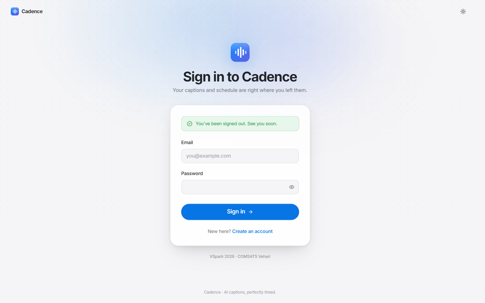

---

## 9. Testing

- **End-to-end** (`npm run test:e2e`): health check → landing → `/dashboard` redirect when signed out → `/api/generate` returns 401 and `/api/cron/notify` rejects requests without the secret → sign-up validation → sign-up → empty studio → prompt + platform → **Generate captions** → pick an option → time + notes → **Schedule post** → save a second option as a draft → feed → edit caption → notification settings → delete via confirm dialog → Drive connect redirects to Google → mobile → sign out → route protected again. AI steps are soft (a missing `GEMINI_API_KEY` is reported as a warning, not a failure); set `STRICT=1` to make them fatal. Options: `BASE_URL`, `EMAIL` + `PASSWORD` (existing account), `HEADED=1`.
- **Security** (`npm run test:security`): two throwaway users via the public key. Verifies the owner can create/read/delete a post; anonymous visitors and the other user cannot read, update or delete it or insert one in the owner's name; settings and the email log are private and can't be forged; `refresh_token` can't be selected from `drive_connections`; `rate_limits` can't be read or written; `check_rate_limit` allows 2 of 2 then blocks the third, keeps quotas per user, and rejects anonymous callers.
- **Static**: `npm run check` (TypeScript strict + ESLint), `npm run build`.

## 10. Project structure

```
src/
  app/
    (marketing)/            landing page + public header/footer
    (auth)/                 /login, /signup
    auth/                   /auth/callback, /auth/confirm (email link handlers)
    dashboard/              the protected single-page studio
    api/
      generate/             POST: Gemini captions (auth, zod, rate limit)
      drive/connect/        GET: start Google OAuth (CSRF state cookie)
      drive/callback/       GET: exchange code, store refresh token, create folder
      cron/notify/          GET: pg_cron → due reminders (Bearer CRON_SECRET)
      health/               GET: deployment check
    error.tsx, not-found.tsx, layout.tsx, globals.css
  components/
    ui/                     design-system primitives (button, inputs, dialogs, sheet, badges...)
    studio/                 studio, generator, caption options, schedule composer,
                            post feed, drive status, notification settings, email activity
    auth/                   sign-in / sign-up forms
  lib/
    actions/                Server Actions: auth, posts (C/U/D), notifications, drive
    data/                   read queries (posts, studio data)
    services/               gemini.ts, google-drive.ts, email.ts (external APIs, server-only)
    validation/             zod schemas run by the server (auth, post, notifications); auth schemas also run in the browser
    email/                  email templates (HTML + text)
    supabase/               browser / server / proxy clients + admin (secret key, server-only)
    auth/dal.ts             the only place that reads the session
    rate-limit.ts           check_rate_limit RPC wrapper + LIMITS
    env.ts                  typed env access + is*Configured() helpers
  proxy.ts                  Next.js 16 proxy (session refresh + redirects)
  types/db.ts               row + domain types (PostRow, CaptionOption, Platform...)
supabase/
  migrations/               database setup, applied in order
  cron.sql                  pg_cron job for reminder emails
scripts/                    e2e + screenshots, security check
docs/                       DEFENSE.md (demo script + Q&A), screenshots/
```

---

Captions by [Google Gemini](https://ai.google.dev). Email by [Resend](https://resend.com). Drafts stored in the user's own Google Drive.
