# EventDesk

**A full-stack event planner: secure accounts, private event records, cloud file storage, and live weather + maps for every venue.**

Built for the VSpark 2026 Web Development Competition (COMSATS University Islamabad, Vehari Campus).

| | |
| --- | --- |
| **Live URL** | `https://YOUR-APP.vercel.app` ← replace after deploying |
| **Repository** | `https://github.com/YOUR-USERNAME/eventdesk` ← replace |
| **Stack** | Next.js 16 (App Router, Turbopack) · React 19 · TypeScript · Supabase (Postgres, Auth, Storage) · Tailwind CSS v4 · Zod · Open-Meteo API · OpenStreetMap |

---

## Contents

1. [Features (mapped to the judging rubric)](#1-features-mapped-to-the-judging-rubric)
2. [Architecture overview](#2-architecture-overview)
3. [Environment variables and API keys](#3-environment-variables-and-api-keys)
4. [Setup guide (step by step)](#4-setup-guide-step-by-step)
5. [Deployment (Vercel)](#5-deployment-vercel)
6. [Screenshots: each pipeline, in order](#6-screenshots-each-pipeline-in-order)
7. [Testing](#7-testing)
8. [Security](#8-security)
9. [Project structure](#9-project-structure)

---

## 1. Features (mapped to the judging rubric)

| Rubric criterion | What EventDesk does | Where in the code |
| --- | --- | --- |
| **UI/UX & Responsiveness** | Clean editorial design, light/dark theme, mobile drawer navigation, skeleton loaders, toasts, empty states, accessible forms (labels, ARIA errors, keyboard support) | `src/components/**`, `src/app/globals.css` |
| **Authentication Flow** | Email sign-up (name, email, password + confirm), sign-in, sign-out, cookie sessions refreshed on every request, protected pages, Server Actions and API routes, `?next=` return after login | `src/lib/actions/auth.ts`, `src/proxy.ts`, `src/lib/auth/dal.ts` |
| **Database & CRUD** | Events: **Create** (form), **Read** (list with search, filters, sort, pagination + detail page), **Update** (edit form), **Delete** (confirm dialog). Attachments: create, read, delete. Dashboard stats via count queries | `src/lib/data/events.ts`, `src/lib/actions/events.ts`, `supabase/migrations/` |
| **Cloud Storage** | Cover images and attachments (images, PDF, TXT, DOCX, 10 MB max) uploaded to a **private** Supabase Storage bucket, rendered back through **expiring signed URLs**; files removed from storage when replaced or deleted | `src/lib/storage.ts`, `src/components/events/attachments-panel.tsx`, `src/lib/actions/attachments.ts` |
| **External API** | **Open-Meteo Geocoding API** (live venue search) and **Open-Meteo Forecast API** (current weather + 16-day forecast, event-day highlight), plus an **OpenStreetMap** embed and Google Maps directions link. Timeouts, one retry, typed errors, loading / error-with-retry / empty states | `src/lib/services/open-meteo.ts`, `src/app/api/*`, `src/components/events/weather-panel.tsx`, `location-search.tsx` |
| **Deployment** | Vercel-ready, health endpoint at `/api/health`, production build verified | `next.config.ts`, [section 5](#5-deployment-vercel) |
| **Code Quality & Architecture** | Feature-based folders, a single Data Access Layer for sessions, shared Zod schemas validate on **client and server**, DB `CHECK` constraints as the last line, error boundaries, typed results | [section 9](#9-project-structure) |
| **Documentation** | This README, `.env.example`, setup steps, screenshots | you're reading it |

---

## 2. Architecture overview

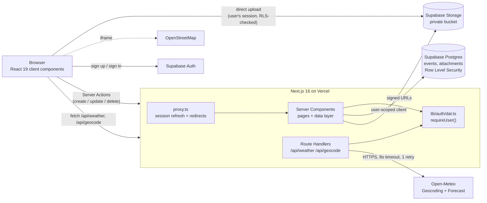

**Request lifecycle**

1. Every request passes through `src/proxy.ts` (Next.js 16's replacement for middleware). It refreshes the Supabase session cookie and redirects signed-out users away from `/dashboard/**` (and signed-in users away from `/login`, `/signup`).
2. Pages are **Server Components**. They call the data layer (`src/lib/data/events.ts`), which calls `requireUser()` and queries Postgres with the **user-scoped** Supabase client, so Row Level Security applies to every query.
3. Mutations are **Server Actions** (`src/lib/actions/*`). Each one re-checks the session, re-validates input with the same Zod schema the form used, writes, and calls `revalidatePath()` so the UI refreshes.
4. File bytes go **directly from the browser to Supabase Storage** (no 4.5 MB serverless body limit). Storage policies only allow writing inside the user's own folder; a Server Action then records the file's metadata.
5. The weather and geocoding APIs are called **server-side** through our own protected route handlers, so the client never talks to third parties directly and responses are cached (15 min forecast, 24 h geocoding).

**Data model**

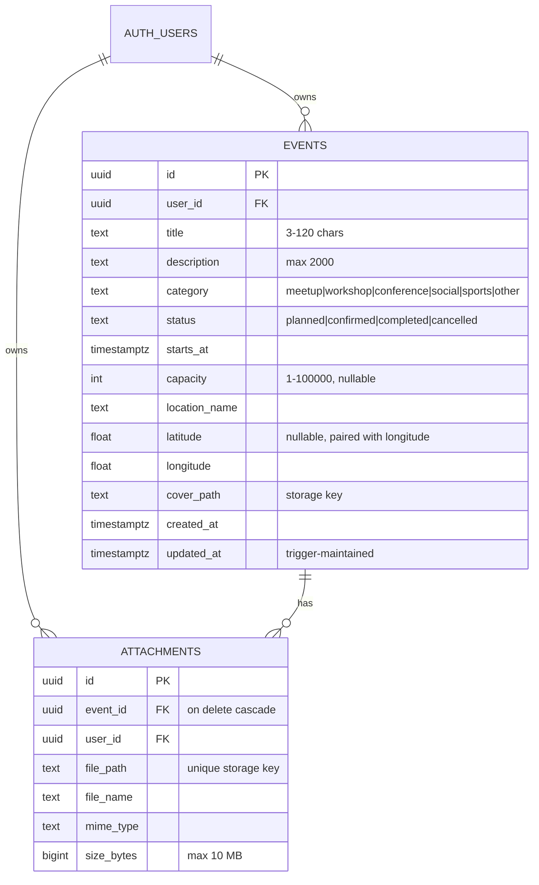

Storage layout (bucket `event-files`, private): `{user_id}/covers/{file}` and `{user_id}/{event_id}/{file}`.

---

## 3. Environment variables and API keys

Copy `.env.example` to `.env.local` and fill in:

| Variable | Required | Where to get it | Purpose |
| --- | --- | --- | --- |
| `NEXT_PUBLIC_SITE_URL` | yes | Your URL: `http://localhost:3000` locally, `https://your-app.vercel.app` in production | Builds the redirect link in sign-up confirmation emails |
| `NEXT_PUBLIC_SUPABASE_URL` | yes | Supabase → Project Settings → API → Project URL | Supabase endpoint |
| `NEXT_PUBLIC_SUPABASE_PUBLISHABLE_KEY` | yes | Supabase → Project Settings → API Keys → **Publishable key** (`sb_publishable_...`), or the legacy **anon** key | Public client key. Safe in the browser because Row Level Security protects all data |

**API keys needed:** only the two Supabase values above.

| External service | Key needed? | Notes |
| --- | --- | --- |
| Supabase (Auth, Postgres, Storage) | Yes (URL + publishable key) | Free tier is enough |
| Open-Meteo Geocoding API | **No** | Free production API, `geocoding-api.open-meteo.com` |
| Open-Meteo Forecast API | **No** | Free production API, `api.open-meteo.com` |
| OpenStreetMap embed | **No** | Map tiles + marker via iframe |

The app needs **no server secret** (no service-role key): every query runs as the signed-in user. `.env.local` is git-ignored; only `.env.example` (no real values) is committed.

---

## 4. Setup guide (step by step)

### Prerequisites
- Node.js **20.9+** and npm
- A free [Supabase](https://supabase.com) account (or Docker Desktop for the local option)

### Option A: hosted Supabase (recommended, same as production)

1. **Install dependencies**
   ```bash
   npm install
   cp .env.example .env.local        # Windows PowerShell: Copy-Item .env.example .env.local
   ```
2. **Create a Supabase project** at supabase.com → New project.
3. **Create the database**: Supabase → **SQL Editor** → New query → paste the whole of
   `supabase/migrations/20261118000001_init.sql` → **Run**. This creates both tables, Row Level Security policies, the trigger, and the private `event-files` storage bucket with its policies.
4. **Configure auth**: Authentication → **Sign In / Providers** → Email → turn **Confirm email OFF** (users are signed in straight after sign-up; turn it on if you want email verification, the app handles both).
   Authentication → **URL Configuration** → Site URL = your site URL; add `http://localhost:3000/**` and `https://your-app.vercel.app/**` to Redirect URLs.
5. **Add keys** to `.env.local` (see [section 3](#3-environment-variables-and-api-keys)).
6. **Run**
   ```bash
   npm run dev                       # http://localhost:3000
   ```
7. Open the app → **Get started** → create an account → **New event**.

### Option B: fully local Supabase (Docker)

```bash
npm install
npx supabase start                 # starts Postgres/Auth/Storage in Docker and applies the migration
npx supabase status -o env         # copy API_URL and PUBLISHABLE_KEY into .env.local
npm run dev
```
Local ports are 553xx (API `http://127.0.0.1:55321`, Studio `http://127.0.0.1:55323`) so they don't clash with other Supabase projects. Stop with `npx supabase stop`.

### Useful scripts

| Command | What it does |
| --- | --- |
| `npm run dev` | Development server |
| `npm run build` / `npm start` | Production build / serve |
| `npm run typecheck` · `npm run lint` · `npm run check` | TypeScript, ESLint, both |
| `npm run test:security` | Proves RLS isolation between two users (13 checks) |
| `npm run test:e2e` | Drives the real app in Chrome through every pipeline and saves screenshots |

---

## 5. Deployment (Vercel)

1. Push the repository to GitHub (public).
2. [vercel.com/new](https://vercel.com/new) → **Import** the repo. Framework preset: **Next.js** (auto-detected). No build settings to change.
3. **Environment Variables** → add `NEXT_PUBLIC_SITE_URL` (your Vercel URL), `NEXT_PUBLIC_SUPABASE_URL`, `NEXT_PUBLIC_SUPABASE_PUBLISHABLE_KEY` → **Deploy**.
4. In Supabase → Authentication → URL Configuration, set **Site URL** to the Vercel URL and add `https://your-app.vercel.app/**` to Redirect URLs.
5. Verify: open `https://your-app.vercel.app/api/health`. It should return `{"status":"ok","supabaseConfigured":true,...}`.
6. Run the end-to-end check against production:
   ```bash
   BASE_URL=https://your-app.vercel.app npm run test:e2e
   # PowerShell: $env:BASE_URL="https://your-app.vercel.app"; npm run test:e2e
   ```

> `NEXT_PUBLIC_*` variables are baked in at build time. If you change one in Vercel, **redeploy**.

---

## 6. Screenshots: each pipeline, in order

Generated by `npm run test:e2e`, which also asserts that each step works.

### Landing page


### Auth pipeline
| Route protection: `/dashboard/events` while signed out → `/login?next=...` | Sign-up validation (client + server) |
| --- | --- |
|  |  |

| Sign-up form | First sign-in: empty dashboard |
| --- | --- |
|  | 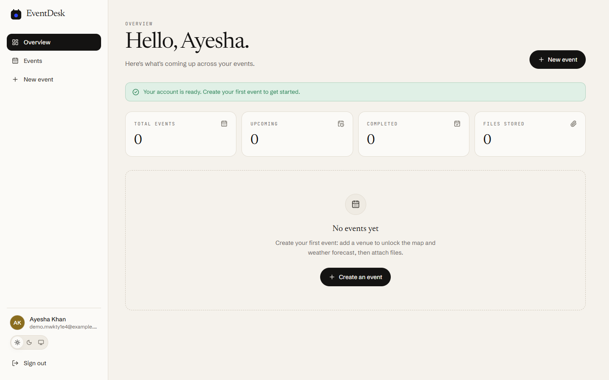 |

### Create (database + storage + external API)
Venue picked with the live Open-Meteo geocoding search; cover image uploaded to the private bucket.
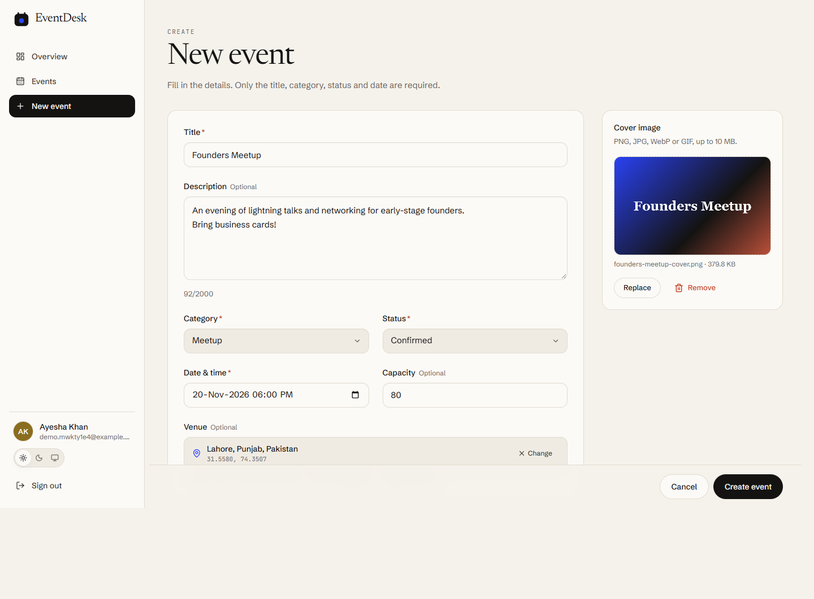

### Read: event detail with live weather and map
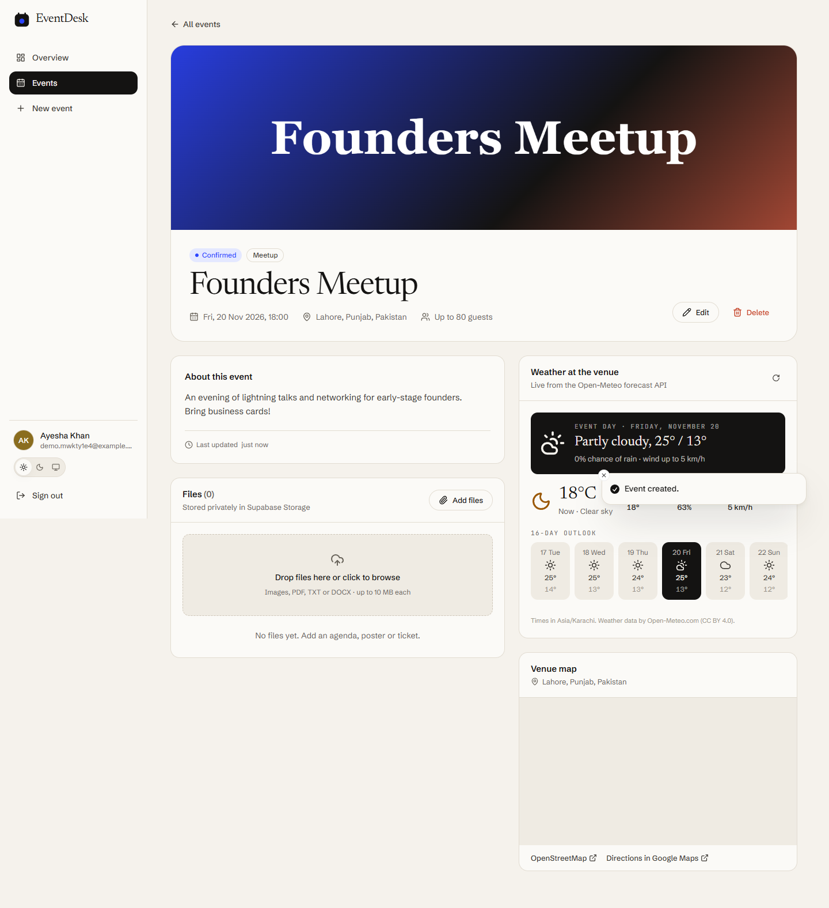

### Cloud storage: attachments uploaded and rendered via signed URLs
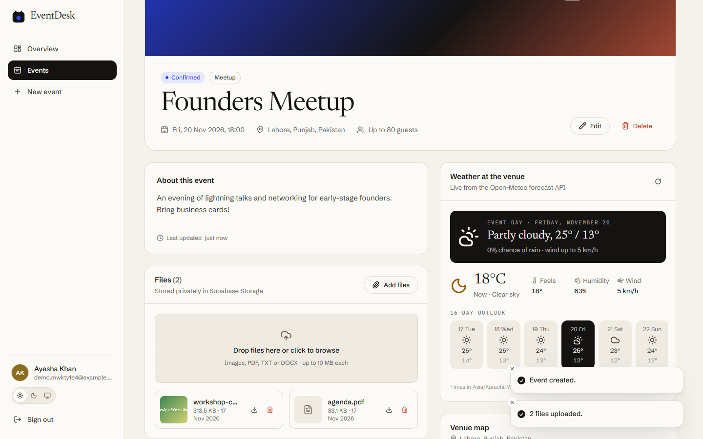

### Validation errors
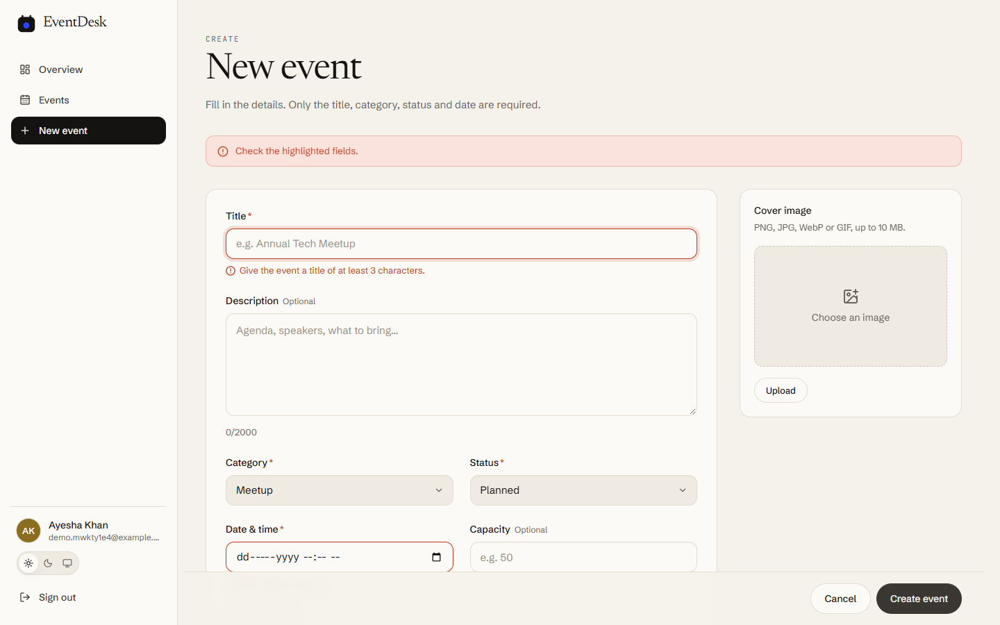

### List, search and filter
| Events list | Search ("workshop") |
| --- | --- |
| 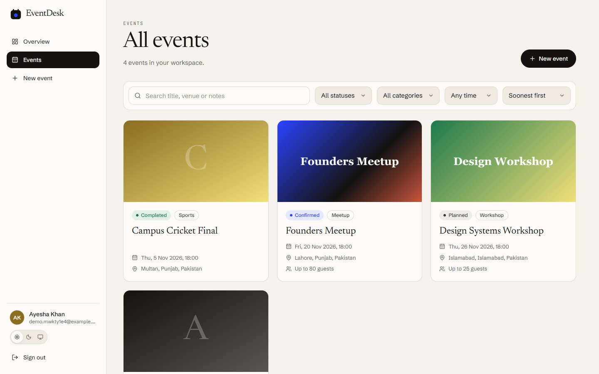 | 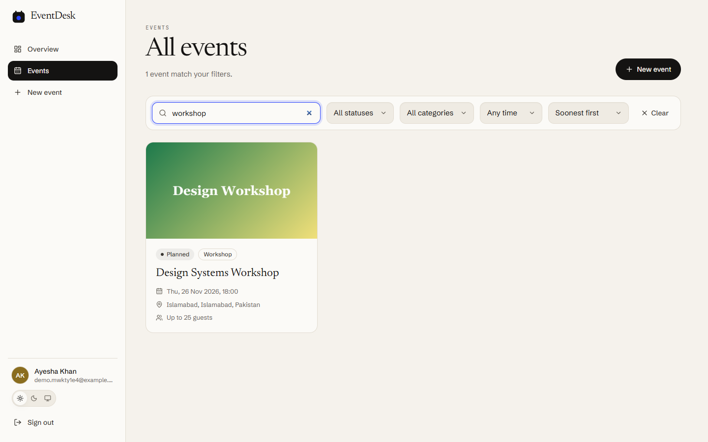 |

### Update and delete
| Edit | Delete confirmation |
| --- | --- |
| 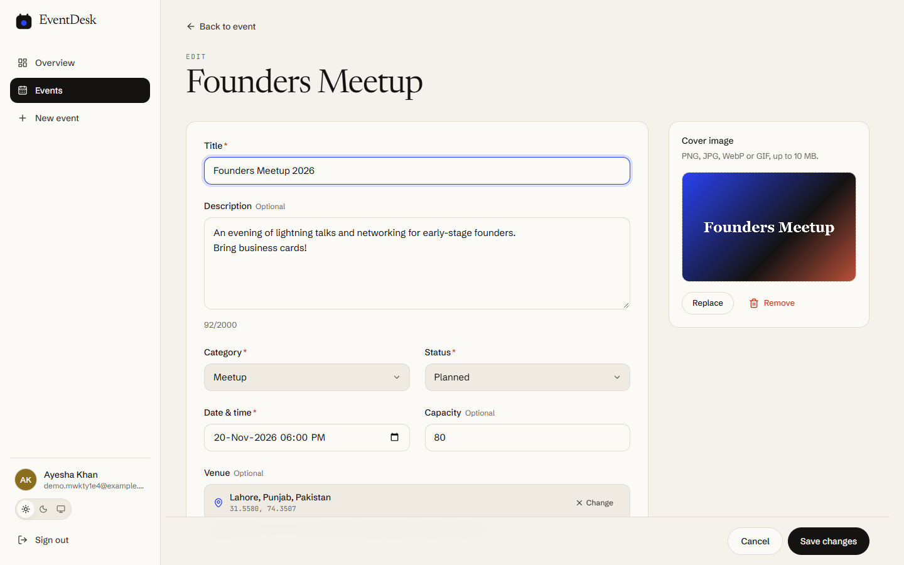 | 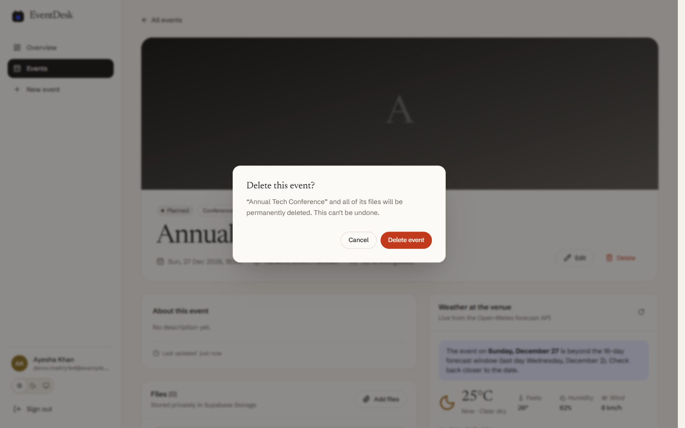 |

### Dashboard


### Responsive (mobile)
| Events on mobile | Mobile navigation |
| --- | --- |
| 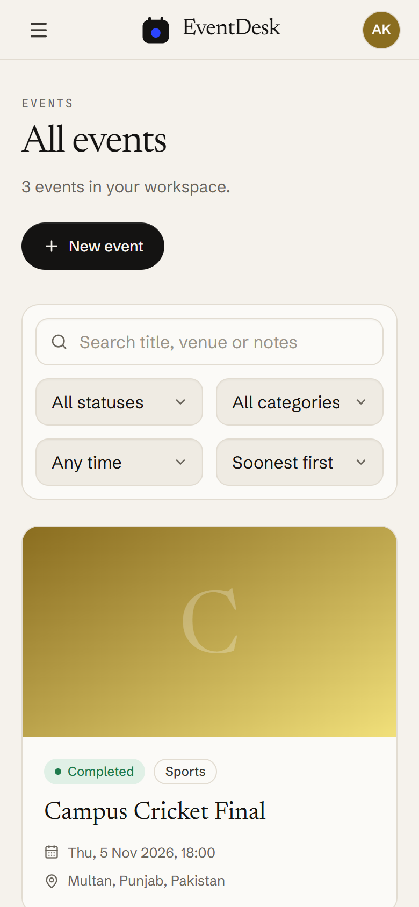 | 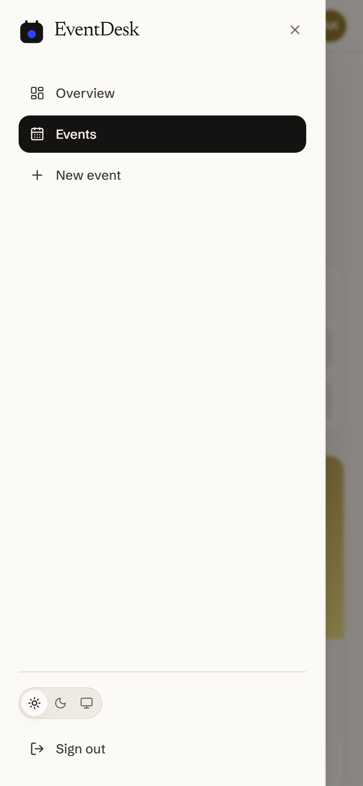 |

### Sign out


---

## 7. Testing

- **End-to-end** (`npm run test:e2e`): health check → landing → protected route redirect → protected API returns 401 → sign-up validation → sign-up → create event with geocoding + cover upload → weather renders for event day → upload PDF + image → signed URL returns the PDF → create more events → validation errors → list → search → update → delete → dashboard → mobile layouts → sign out → route protected again. Fails loudly on the first broken step.
- **Security** (`npm run test:security`): two throwaway users; verifies the second user cannot read, update, delete, spoof ownership, attach to, download, sign, or upload into the first user's data, that anonymous access is denied, and that the bucket rejects disallowed file types.
- **Static**: `npm run check` (TypeScript strict + ESLint), `npm run build`.

## 8. Security

- **Three layers of route protection**: `proxy.ts` redirects; every page / Server Action / API route calls `requireUser()` / `getCurrentUser()` (JWT verified with `getClaims()`); Postgres **Row Level Security** enforces ownership even if the app layer were bypassed.
- **Validation everywhere**: shared Zod schemas on the client and server; DB `CHECK` constraints; storage bucket size + MIME limits; server checks that file paths sit inside the caller's folder.
- **Private files**: the bucket is private; files are served only via signed URLs that expire after 1 hour.
- **No secrets in the repo**: `.env*` is git-ignored except `.env.example`; the app uses no service-role key at all.
- **Safe redirects**: `?next=` only accepts same-origin relative paths.
- **Headers**: `X-Content-Type-Options`, `X-Frame-Options`, `Referrer-Policy`, `Permissions-Policy`.
- **No account enumeration**: sign-in returns the same message for unknown email and wrong password.

## 9. Project structure

```
src/
  app/
    (marketing)/          landing page + public header/footer
    (auth)/               /login, /signup
    auth/                 /auth/callback, /auth/confirm (email link handlers)
    dashboard/            protected area: overview, events list, new, [id], [id]/edit
    api/                  /api/weather, /api/geocode (protected), /api/health
    error.tsx, not-found.tsx, layout.tsx, globals.css
  components/
    ui/                   design-system primitives (button, inputs, dialogs, badges...)
    app/                  signed-in shell (sidebar, mobile drawer, user menu)
    auth/                 sign-in / sign-up forms
    events/               event card, form, filters, location search, weather, map, attachments
  config/                 site branding + event vocabulary (categories, statuses, sort options)
  lib/
    actions/              Server Actions: auth, events (C/U/D), attachments
    auth/dal.ts           the only place that reads the session
    data/events.ts        read queries (R) + signed URLs
    services/open-meteo.ts external API client (timeout, retry, typed errors)
    supabase/             browser / server / proxy clients
    validation/           Zod schemas shared by client + server
    storage.ts            bucket name, limits, allowed types, path builders
  proxy.ts                Next.js 16 proxy (session refresh + redirects)
  types/db.ts             row types
supabase/migrations/      the complete database + storage setup (one SQL file)
scripts/                  e2e + screenshots, security check
docs/screenshots/         README images
```

---

Weather data by [Open-Meteo.com](https://open-meteo.com) (CC BY 4.0). Map data © [OpenStreetMap](https://www.openstreetmap.org/copyright) contributors.
