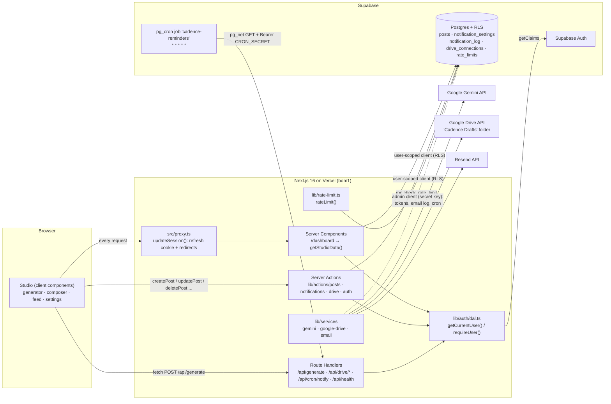
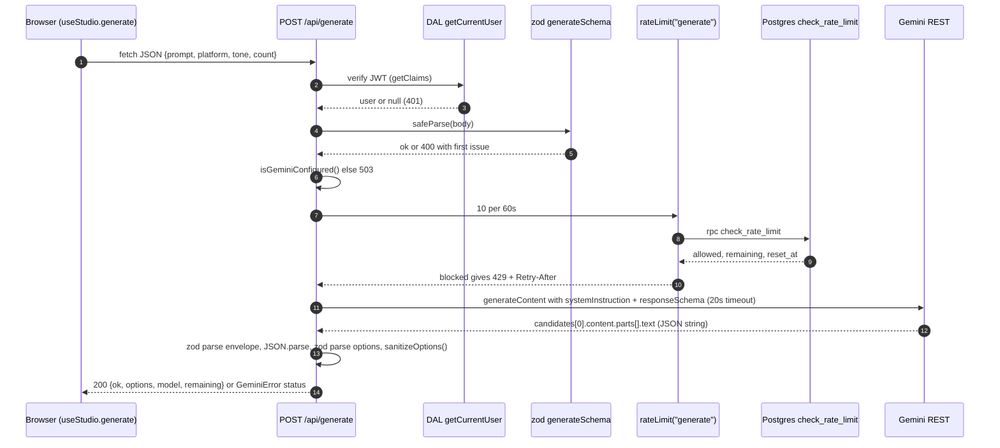
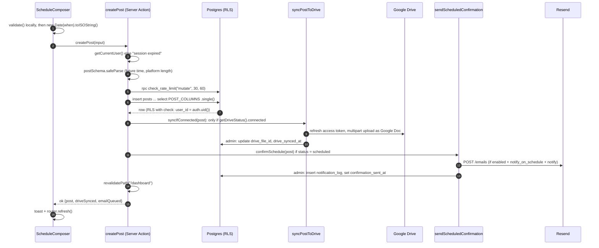
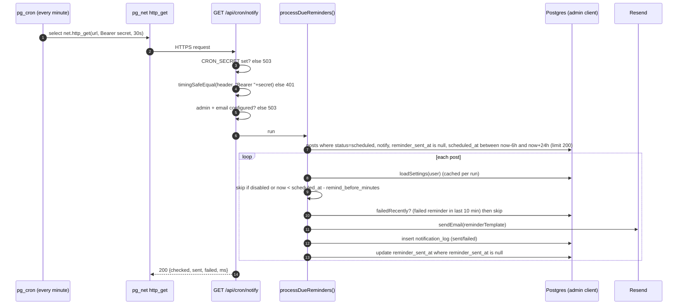
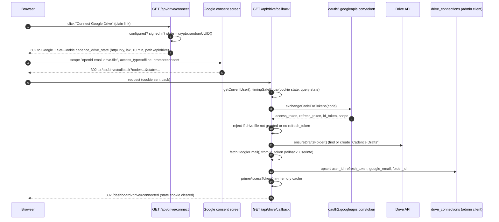
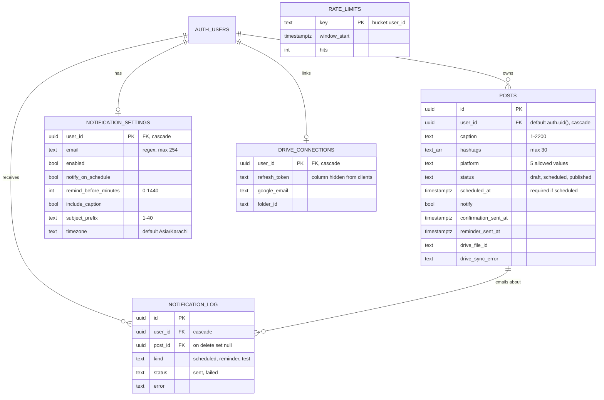

# Cadence: Viva and Technical Defense Guide

This guide is for defending Cadence live. Every claim below comes from the code in this repository, with the file and function named so you can open it on screen if a judge asks.

How to use it:

- **Night before:** read sections 1 to 6 in order, then the "Do not over-claim" box below.
- **30 minutes before:** reread section 10 (the cheat sheet) and section 12 (the demo script).
- **During questions:** answer in plain English first ("RLS means the database itself checks who owns a row"), then give the technical detail ("the policy is `user_id = (select auth.uid())` for both `using` and `with check`"), then point at the file.

> **Do not over-claim. The code does NOT do these things (some older docs suggest it does):**
>
> 1. **Gemini output is not trimmed to the platform's character limit.** The prompt asks Gemini to respect the limit, and `sanitizeOptions()` in `src/lib/services/gemini.ts` trims captions, cleans and de-duplicates hashtags (max 10) and caps the option count. The platform limit (X 280, Instagram 2200, LinkedIn 3000...) is enforced **when you save**, by `platformLengthError()` in `src/lib/validation/post.ts` and by the live counter in the composer.
> 2. **The default model is `gemini-flash-latest`** (`src/lib/env.ts`), not `gemini-2.5-flash`. If the model returns 404, `modelChain()` falls back to `gemini-2.5-flash`, then `gemini-flash-latest`, then `gemini-2.0-flash`.
> 3. **Cadence does not post to Instagram, X and the rest.** It writes captions, schedules them, syncs them to Drive and emails you. The "Published" label in the feed is worked out in the browser by `effectiveStatus()` in `src/components/studio/post-card.tsx`: a scheduled post whose time has passed shows as published. The server never writes `status = 'published'`.
> 4. **Drive sync has its own rate-limit bucket, `drive_sync`** (30 per minute, the same numbers as `mutate`). It is not counted in `mutate`.
> 5. **Only the auth forms run the exact same zod schema in the browser** (`useAuthForm()` in `src/components/auth/auth-forms.tsx`). The composer and the edit dialog use lightweight hand-written checks with the same limits. The server always runs the full zod schema (`postSchema` / `postUpdateSchema`).
> 6. **The rate limiter fails open.** If the `check_rate_limit` RPC itself errors, `rateLimit()` lets the request through and logs the error (`failOpen()` in `src/lib/rate-limit.ts`). This is a deliberate trade-off, so be ready to defend it (Q24).
> 7. **Migration `20261118000001_init.sql` is left over from the EventDesk starter** (events, attachments, a storage bucket). Cadence's schema lives entirely in `20261118000002_cadence.sql`. That is also why `package.json` is named `eventdesk` and the Vercel URL is `eventdesk-self.vercel.app`. If asked, say so plainly (Q40).

---

## 1. Elevator pitch and the brief

**Pitch (say this in about 30 seconds):**
Cadence is an AI social media studio. You describe a post in one sentence and pick a platform and a tone. Google Gemini writes two or three caption options with hashtags. You pick one, edit it, choose a date and time, add task notes, and schedule it. Cadence saves the post in Postgres, files a copy as a Google Doc in a "Cadence Drafts" folder in your own Google Drive, sends a confirmation email at once, and sends a reminder email N minutes before the post is due. The reminder is driven by a database cron job that runs every minute. Each user sees only their own data, and the database enforces that rule itself.

| # | Brief requirement | Cadence feature | Main files |
| --- | --- | --- | --- |
| 1 | AI generates caption options with hashtags | Generator: prompt + platform (5) + tone (6) + count (2 or 3) → `POST /api/generate` → Gemini REST with a JSON response schema → zod-validated, sanitised options | `src/components/studio/generator.tsx`, `use-studio.ts`, `src/app/api/generate/route.ts`, `src/lib/services/gemini.ts`, `src/lib/validation/generate.ts` |
| 2 | Pick one, pick a time, save, sync to cloud | Caption options → Schedule composer (edit caption and hashtags, datetime-local, task notes, email toggle) → `createPost` Server Action → Postgres insert → `syncPostToDrive()` creates a Google Doc in "Cadence Drafts" | `caption-options.tsx`, `schedule-composer.tsx`, `src/lib/actions/posts.ts`, `src/lib/services/google-drive.ts` |
| 3 | Feed of saved and scheduled posts with edit and delete | `PostFeed` with filter tabs and search; `PostCard` with Edit dialog (`updatePost`), Delete confirm (`deletePost`), Sync now (`syncPostNow`), schedule/unschedule toggle, copy | `post-feed.tsx`, `post-card.tsx`, `src/lib/data/posts.ts` (`listPosts`, `sortPosts`) |
| 4 | Automated email per scheduled post, customisable notifications | Immediate confirmation (`sendScheduledConfirmation`) plus a pg_cron reminder every minute (`/api/cron/notify` → `processDueReminders`). Settings: address, on/off, confirm-on-schedule, lead time (0 min to 1 day), include caption, subject prefix, time zone. Test email. Activity log | `notification-settings.tsx`, `email-activity.tsx`, `src/lib/actions/notifications.ts`, `src/lib/services/email.ts`, `src/lib/email/templates.ts`, `supabase/cron.sql` |
| 5 | Deployed | Vercel (region `bom1`, set in `vercel.json`), `GET /api/health`, every secret in Vercel env vars | `vercel.json`, `src/app/api/health/route.ts`, `.env.example` |

---

## 2. Tech stack, and why each piece

| Choice | What it is | Why it was chosen (say this) |
| --- | --- | --- |
| **Next.js 16 App Router** | React framework with server and client components | One codebase covers the UI, the server logic (Server Actions) and the HTTP endpoints (Route Handlers). Server Components fetch data on the server, so secrets never reach the browser. Next 16 renames `middleware.ts` to `proxy.ts`. |
| **React 19 Server Components** | `/dashboard/page.tsx` is async and runs on the server | The page calls `getStudioData()` directly, with no client-side fetch and no loading spinner for first paint. |
| **Server Actions** | `"use server"` functions in `src/lib/actions/*` | Type-safe mutations that the UI calls like normal functions. Next.js only accepts them as POST and checks the Origin header against the host (CSRF protection), and `revalidatePath("/dashboard")` refreshes the feed after a change. |
| **Route Handlers** | `src/app/api/**/route.ts` | Used where something outside our UI calls us (the Google OAuth redirect, pg_cron) or where the client needs real HTTP status codes and headers (`/api/generate` returns 429 with `Retry-After`). |
| **Supabase Auth** | Email and password auth, JWT in HTTP-only cookies via `@supabase/ssr` | Managed and free. Cookie sessions work with Server Components. `getClaims()` verifies the JWT signature. |
| **Supabase Postgres + RLS** | Managed Postgres with Row Level Security | Authorisation lives in the database: even if someone bypasses the app with the public key, policies only return that user's rows. CHECK constraints are the last line of validation. |
| **pg_cron + pg_net** | Postgres extensions: a scheduler, and HTTP calls from SQL | A minute-level schedule for free. Vercel Cron on the Hobby plan runs at most once a day, which is useless for "remind me 15 minutes before". |
| **Google Gemini (REST)** | `generativelanguage.googleapis.com/v1beta/models/{model}:generateContent` | Free tier, fast "flash" models, and **structured output** (`responseMimeType: "application/json"` + `responseSchema`), so we get JSON rather than prose. Plain `fetch`, no SDK, keeps it small and transparent. |
| **Google Drive API via OAuth 2.0** | Authorization-code flow, `drive.file` scope, refresh token | Drafts go to the **user's own** Drive (cloud storage they control). `drive.file` is the narrowest scope: the app sees only files it created. |
| **Resend** | Transactional email REST API | One HTTP call, free tier (100 emails/day), good deliverability. Plain `fetch`, no SDK. |
| **Vercel** | Serverless hosting for Next.js | Zero-config Next.js deploys, env var management, functions pinned to `bom1` (Mumbai), close to users in Pakistan. |
| **Tailwind CSS v4** | CSS-first config (`@import "tailwindcss"`, `@theme inline` in `globals.css`) | Fast styling with design tokens in CSS. Dark mode via `@custom-variant dark`. Loaded through `@tailwindcss/turbopack` (`next.config.ts`). |
| **Zod v4** | Runtime schema validation | TypeScript types vanish at runtime. Zod checks every untrusted input: form data, JSON bodies, Gemini output, Google token responses, RPC results. |
| **TypeScript strict, no `any`** | `"strict": true` in `tsconfig.json`; ESLint `@typescript-eslint/no-explicit-any: "error"` in `eslint.config.mjs` | Any `any` fails lint. Unknown data is typed `unknown`, then narrowed with zod or type guards (for example `isGenerateResponse()` in `use-studio.ts`). |

---

## 3. Architecture

### 3.1 Diagram



### 3.2 Layers in plain words

| Layer | Folder | Job | Rule |
| --- | --- | --- | --- |
| Proxy | `src/proxy.ts`, `src/lib/supabase/proxy.ts` | Refresh the session cookie and redirect by auth state | Runs on every non-static request |
| Pages | `src/app/**/page.tsx` | Render; read data on the server | Never trust the client |
| Data Access Layer | `src/lib/auth/dal.ts` | The **only** place that reads the session | Every page, action and route calls it |
| Reads | `src/lib/data/posts.ts` | `listPosts()`, `getStudioData()` | User-scoped client, RLS applies |
| Writes | `src/lib/actions/*.ts` | Server Actions return `ActionResult` | Pattern: auth → zod → rate limit → DB → side-effects → revalidate |
| Services | `src/lib/services/*.ts` | Talk to Gemini, Drive and Resend | `server-only`; typed errors; timeouts |
| Validation | `src/lib/validation/*.ts` | Zod schemas | Mirror the DB CHECK constraints |
| Types | `src/types/db.ts` | Row and domain types | One source of truth; no `any` |

### 3.3 Request lifecycle, one request end to end

1. The browser requests `/dashboard`. The `matcher` in `src/proxy.ts` covers it, because it is not a static asset.
2. `updateSession()` (`src/lib/supabase/proxy.ts`) creates a Supabase server client bound to the request cookies and calls `supabase.auth.getClaims()`. That call verifies the JWT and, if the access token has expired, uses the refresh token to issue new cookies through `setAll`.
3. If there is no `sub` claim and the path starts with `/dashboard`, it redirects to `/login?next=/dashboard`. If the user is signed in and visiting `/login` or `/signup`, it redirects to `/dashboard`, or to a safe `next` path.
4. `src/app/dashboard/layout.tsx` calls `requireUser("/dashboard")`. This is layer 2: it checks again and does not trust the proxy alone.
5. `src/app/dashboard/page.tsx` awaits `getStudioData()` and `searchParams` in parallel and renders `<Studio data=... driveNotice=... />`.
6. `getStudioData()` runs four queries in parallel with `Promise.all`. Each one uses the user-scoped client, so RLS (layer 3) filters every row.
7. Client components hydrate. From then on the user changes data with Server Actions (POST under the hood) and calls `fetch` for generation.

---

## 4. The full user workflow, step by step

### Step 1: Sign up

**What the user sees:** the `/signup` form (name, email, password, confirm). Mistakes show inline at once.

**What the code does:**
1. `SignUpForm` in `src/components/auth/auth-forms.tsx` runs `signUpSchema.safeParse()` on submit, in the browser. If that fails, the form does not submit and the first bad field gets focus.
2. The form action is the Server Action `signUp()` (`src/lib/actions/auth.ts`). It parses `FormData` with the **same** `signUpSchema` (`src/lib/validation/auth.ts`): name 2 to 80 characters, valid lowercased email, password 8 to 72 characters with at least one letter and one number, and `confirm` must match (via `.refine`).
3. It calls `supabase.auth.signUp({ email, password, options: { data: { full_name }, emailRedirectTo: absoluteUrl("/auth/callback?next=/dashboard") } })`.
4. Errors become friendly messages: `user_already_exists`, `weak_password`, and 429 ("too many attempts").
5. Email confirmation is off in Supabase, so `data.session` exists, and the action calls `revalidatePath("/", "layout")` and `redirect("/dashboard?welcome=1")`. If confirmation were on, it would return `{ needsConfirmation: true }` and the link would land on `/auth/callback` (PKCE `exchangeCodeForSession`) or `/auth/confirm` (`verifyOtp` with a token hash).
6. Sign-in (`signIn()`) returns the **same** message for a wrong email and a wrong password, so nobody can use it to find out which accounts exist. It redirects through `safeNext()`.

### Step 2: The studio loads, via `getStudioData()`

`src/lib/data/posts.ts`:

```ts
const [posts, drive, settings, log] = await Promise.all([
  listPosts(),                                  // posts, RLS + .eq("user_id", user.id)
  getDriveStatus(user.id).catch(() => DRIVE_FALLBACK),
  getNotificationSettings().catch(() => settingsFallback()),
  getNotificationLog(8).catch(() => []),
]);
```

- `listPosts()` selects `POST_COLUMNS`, then `sortPosts()` orders them: upcoming scheduled posts soonest first, then drafts newest first, then past posts most recent first.
- `getDriveStatus()` (`google-drive.ts`) reads only `user_id, google_email, folder_id` with the **user** client. The column grant would block `refresh_token` anyway.
- `getNotificationSettings()` returns the saved row, or defaults (account email, 15 minutes, `Asia/Karachi`).
- `getNotificationLog(8)` returns the last 8 emails.
- Stats (`total`, `scheduled`, `drafts`, `synced`) are counted in memory.
- **Graceful degradation:** each integration has its own `.catch()` fallback, so a Drive or settings failure never breaks the page. Only `listPosts()` throws, and `src/app/dashboard/error.tsx` catches that ("Your studio didn't load. Your posts are safe.").

### Step 3: Generate captions



**Client (`src/components/studio/use-studio.ts`, `generate()`):**
- Skips the call if the prompt is under 3 characters, a request is already loading, or a cooldown is running.
- Aborts any earlier in-flight request with an `AbortController`.
- Maps status codes to UI states: **429** starts a countdown from `retryAfterSeconds` or the `Retry-After` header, and the button reads "Try again in Ns". **503** shows "AI isn't configured yet". **401** shows "session expired". **400** shows the validation message. Anything else shows the message with a **Retry** button. A network failure shows "We couldn't reach the server".

**Server (`src/app/api/generate/route.ts`, `POST`):** `runtime = "nodejs"`, `maxDuration = 30`, always `Cache-Control: no-store`. Order of checks: auth (401), JSON body (400), `generateSchema` (400), configured (503), rate limit (429), then Gemini.

**Gemini service (`src/lib/services/gemini.ts`):**
- `buildSystemInstruction()` sets the copywriter role, asks for N distinct options with varied angles (hook, story, call to action), 3 to 8 hashtags without `#`, no repeated hashtags in the caption, and "never invent facts, prices, dates or statistics".
- `RESPONSE_SCHEMA` is `{ options: [{ caption: STRING, hashtags: [STRING] }] }`, passed as `generationConfig.responseSchema` with `responseMimeType: "application/json"` and `temperature: 0.9`.
- The API key travels in the `x-goog-api-key` header, never in the URL.
- `callModel()` validates in five steps:
  1. `geminiResponseSchema` checks the envelope.
  2. A safety block (`promptFeedback.blockReason` or `finishReason` `SAFETY` / `PROHIBITED_CONTENT`) becomes 422.
  3. It joins the text parts and runs `JSON.parse`. Failure means 502 "malformed".
  4. `optionsPayloadSchema` checks the shape. Failure means 502.
  5. `sanitizeOptions()` trims, drops empty captions, runs `cleanTag()` (strips `#` and keeps only Unicode letters, numbers and `_`), de-duplicates case-insensitively, keeps at most 10 tags, and keeps at most `count` options. No usable options means 502.
- `generateCaptions()` loops through `modelChain()`. A 404 (model not found) tries the next model; any other error throws a `GeminiError` with an HTTP status.

### Step 4: Select and edit a caption

- `CaptionOptions` renders the cards. Clicking one calls `studio.select(index)`, which copies the caption and hashtags into editable state (`mergeHashtags`, `parseHashtags`) and scrolls the composer into view (`handleSelect` in `studio.tsx`).
- `ScheduleComposer` shows a live character count with `postLength()`, computed as caption + `\n\n` + `#tag #tag`. It is compared with `PLATFORM_LIMITS[platform]`. You can add or remove hashtags, pick a time with `datetime-local` (in the viewer's local time zone), add task notes (max 1000 characters) and toggle the email reminder. There is also a live post preview.

### Step 5: Schedule, via `createPost()`



Details worth saying out loud (`src/lib/actions/posts.ts`):
- **Validation:** `postSchema` (`src/lib/validation/post.ts`) trims the caption (1 to 2200), normalises hashtags (strip `#`, drop whitespace, de-duplicate, max 30, each up to 60 characters), turns empty text into `null`, normalises `scheduled_at` to a UTC ISO string, and in `superRefine` requires a future time for scheduled posts (with a 5-minute grace for clock drift, `SCHEDULE_GRACE_MS`) plus the platform length check.
- **Insert:** passes `user_id: user.id`, and the column also defaults to `auth.uid()`. RLS `with check` rejects any other id.
- **Error mapping:** `dbFail()` turns Postgres error codes into friendly copy: `23514` (check violation), `23502` (not null), `42501` (RLS permission denied), `PGRST116` (no row). Raw database messages never reach the UI.
- **Side effects never lose the post.** The row is committed first. A Drive failure is stored in `drive_sync_error` and shown as a badge. An email failure is logged as `failed` in `notification_log`. Both are wrapped in try/catch (`syncIfConnected`, `confirmSchedule`).
- "Save draft" is the same action with `status: "draft"`: no time is required and no email is sent.

### Step 6: Edit and delete from the feed

**`updatePost(id, patch)`:**
1. Session check, `postIdSchema` (UUID), `postUpdateSchema` (a partial schema; "Nothing to update" if empty), rate limit `mutate`.
2. Reads the existing row with `.eq("id").eq("user_id")`, so another user's id returns "not found".
3. Builds **merged** values (existing + patch) and re-checks the platform length and the schedule rules on the merged result.
4. If the time or status changed, it resets `reminder_sent_at` and `confirmation_sent_at` to `null`, so the new schedule gets a fresh confirmation and reminder.
5. Updates the row, re-syncs the Drive Doc (`syncIfConnected`; the doc is PATCHed in place), and re-sends the confirmation only when the time changed or the post became scheduled.

**`deletePost(id)`:** reads `id, drive_file_id` (ownership check), deletes the row, then calls `deletePostFromDrive()` on a best-effort basis (a 404 is fine). The UI asks for confirmation first, in the dialog in `post-card.tsx`.

**Other feed actions:**
- **Sync now:** `syncPostNow` (bucket `drive_sync`).
- **Schedule / move to drafts:** `updatePost(id, { status })`. If a draft has no time, the edit dialog opens instead.
- **Copy caption:** uses the clipboard.

`duplicatePost()` exists in `posts.ts` but no button calls it yet.

### Step 7: Notification settings and the test email

- `NotificationSettingsSheet` (`notification-settings.tsx`) offers: email, enabled, notify on schedule, reminder preset (`REMINDER_PRESETS`: 0, 5, 15, 30, 60, 120, 1440 minutes), include caption, subject prefix, and time zone. It shows a live preview of the subject line.
- **Save:** `saveNotificationSettings(input)` checks the session, runs `notificationSettingsSchema` (email regex, 0 to 1440 minutes, prefix 1 to 40 characters, `isValidTimeZone()` using `Intl`), applies rate limit `mutate`, then `upsert(..., { onConflict: "user_id" })` with the **user** client (RLS owner-only), then revalidates.
- **Test email:** `sendTestEmail()` applies rate limit `email` (**5 per 5 minutes**), loads settings, renders `testTemplate()`, calls `sendEmail()`, then `logEmail()` with the **admin** client, because clients only have SELECT on the log. A failure comes back as `fail(result.error)`, which is the actual Resend reason.
- `EmailActivity` lists the last 8 `notification_log` rows: kind, recipient, sent or failed, and the error.

### Step 8: The reminder cron



- `supabase/cron.sql` enables `pg_cron` and `pg_net`, unschedules any old `cadence-reminders` job (so re-running is safe), and schedules `'* * * * *'` → `net.http_get(url := '.../api/cron/notify', headers := {Authorization: Bearer ...}, timeout_milliseconds := 30000)`.
- It is not a migration, because it contains the deployment URL and the secret.
- The route accepts both GET and POST, with `dynamic = "force-dynamic"` and `runtime = "nodejs"`.
- **Look-ahead of 24 hours** (`REMINDER_LOOKAHEAD_MS`) because the longest lead time is 1440 minutes. **Stale cut-off of 6 hours** (`STALE_AFTER_MS`) so a late deploy does not email about posts that went out long ago.
- **Exactly-once in practice:** `reminder_sent_at` is stamped after a successful send, with a guard `.is("reminder_sent_at", null)`. Failed sends are retried, but at most once every 10 minutes (`failedRecently()`).
- Locally, pg_cron cannot reach localhost, so trigger it by hand: `curl -H "Authorization: Bearer $CRON_SECRET" http://localhost:3000/api/cron/notify`.

### Step 9: Connect Google Drive (OAuth 2.0)



- Error outcomes redirect to `/dashboard?drive=error&reason=...` with reason `not_configured`, `state`, `denied`, `no_refresh_token` or `exchange_failed`. `Studio` shows a toast, then cleans the URL with `history.replaceState`.
- **Token refresh:** `getAccessToken(userId)` reads `refresh_token` with the **admin** client. It reuses a cached access token if more than 60 seconds remain and the cached refresh token matches; otherwise it calls the token endpoint with `grant_type=refresh_token`. An `invalid_grant` response means the user revoked access in Google, so it deletes the connection row and returns "not connected".
- **Doc sync (`syncPostToDrive`):** `buildDocument()` writes plain text (platform, status, time in UTC, tone, caption, hashtags, notes, prompt, post id), uploaded as `multipart/related` with `mimeType: application/vnd.google-apps.document`, so Drive converts it into a Google Doc. If `drive_file_id` exists it PATCHes in place; a 404 (the user deleted the Doc) creates a new one; a 404 on the folder recreates the folder and retries once. `driveFetch()` has a 15-second timeout and one retry on network errors, 429 and 5xx (only for safe calls).
- **Disconnect:** `disconnectDrive()` first calls `revokeDriveAccess()` (POST to Google's `/revoke`), then deletes the row with the user client. The `drive: owner delete` policy allows that.
- **Sync all:** `syncAllPosts()` syncs up to 25 posts that are stale (never synced, or `updated_at` more than 10 seconds after `drive_synced_at`).

### Step 10: Sign out

The account menu in `src/components/app/app-shell.tsx` submits a hidden `<form action={signOut}>`. `signOut()` calls `supabase.auth.signOut()`, which clears the cookies, then `revalidatePath("/", "layout")` and `redirect("/login?signedOut=1")`. Visiting `/dashboard` now redirects to `/login` again.

---

## 5. Database design

All Cadence tables are in `supabase/migrations/20261118000002_cadence.sql`.

### 5.1 ER diagram



### 5.2 Tables

| Table | Key columns and constraints | Indexes and triggers | Purpose |
| --- | --- | --- | --- |
| `posts` | `user_id` FK `auth.users`, `on delete cascade`, default `auth.uid()`. CHECKs: prompt ≤ 500, caption 1 to 2200, `cardinality(hashtags) <= 30`, platform in 5 values, tone ≤ 40, notes ≤ 1000, status in 3 values, and **`posts_scheduled_needs_time`**: `status <> 'scheduled' or scheduled_at is not null` | `posts_user_schedule_idx (user_id, scheduled_at)` for the feed. **Partial index** `posts_due_reminders_idx (scheduled_at) where status='scheduled' and notify and reminder_sent_at is null` for the cron. Trigger `posts_set_updated_at` | The captions, schedule, and email and Drive state |
| `notification_settings` | PK = `user_id` (one row per user). Email regex + ≤ 254, lead time 0 to 1440, prefix 1 to 40, timezone ≤ 64 | `updated_at` trigger | Per-user email preferences |
| `notification_log` | `kind` in (scheduled, reminder, test), `status` in (sent, failed), `post_id` **on delete set null** (history survives a deleted post) | `(user_id, created_at desc)` | Audit trail and activity panel; reminder retry backoff |
| `drive_connections` | PK = `user_id`, `refresh_token not null` | none | Google OAuth link |
| `rate_limits` | PK `key` = `bucket:uid`, `window_start`, `hits` | PK index | Fixed-window counters |

`set_updated_at()` is a trigger function with `set search_path = ''` (hardened). It sets `new.updated_at = now()` before every update.

### 5.3 RLS and grants in plain words

The migration first does `revoke all ... from anon, authenticated`, then grants back only what is needed. RLS is enabled on all five tables.

| Table | Grants to `authenticated` | Policy | Plain English |
| --- | --- | --- | --- |
| `posts` | select, insert, update, delete | `posts: owner all`: `using (user_id = (select auth.uid())) with check (same)` | You can only see, change or create rows that belong to you. You cannot insert a row in someone else's name, and you cannot update a row to give it away. |
| `notification_settings` | select, insert, update | `settings: owner all` (same shape) | Only your own settings. No delete grant. |
| `notification_log` | select | `log: owner read` | You can read your email history but cannot write it. Only the server (admin client) inserts, so a user cannot fake "sent" entries. |
| `drive_connections` | `select (user_id, google_email, folder_id, connected_at)` + delete | `drive: owner read`, `drive: owner delete` | You can see that you are connected and disconnect, but you can never read the token, and you cannot insert one. |
| `rate_limits` | **nothing** | RLS on, no policies | Invisible to users. Only the SECURITY DEFINER function touches it. |
| `anon` | nothing on any table | none | Signed-out visitors get nothing. |

- **`using` versus `with check`:** `using` filters which existing rows you can see or affect (select, update, delete). `with check` validates the new row values (insert, and update after the change).
- **Why `(select auth.uid())` and not `auth.uid()`:** wrapping it in a sub-select lets Postgres evaluate it once per statement (an "initPlan") instead of once per row. Supabase recommends this for performance.

### 5.4 Why the refresh token uses a column-level grant

- RLS works on **rows**, not columns. The owner's own row contains the token, so RLS alone would let the owner's browser (holding the publishable key and their JWT) read their own refresh token. If an XSS bug or a malicious browser extension stole it, the attacker would have long-lived Drive access.
- A **column-level grant** (`grant select (user_id, google_email, folder_id, connected_at)`) makes `select refresh_token`, and even `select *`, fail with *permission denied* for the `authenticated` role.
- Only the server's admin client (secret key, `service_role`, which bypasses RLS and grants) reads and writes it: in `getAccessToken()`, `revokeDriveAccess()`, and the callback `upsert`.
- `scripts/security-check.mjs` proves it: "user cannot SELECT refresh_token" and "user cannot SELECT *".

### 5.5 `check_rate_limit`, line by line

```sql
create or replace function public.check_rate_limit(p_bucket text, p_limit integer, p_window_seconds integer)
returns table (allowed boolean, remaining integer, reset_at timestamptz)
language plpgsql security definer set search_path = '' as $$
```
- `security definer`: the function runs with the **owner's** privileges (postgres), so it can write `rate_limits` even though users have no grants on that table.
- `set search_path = ''`: hardening. Every object must be schema-qualified (`public.rate_limits`), so an attacker cannot create a look-alike table or function earlier in the search path and hijack the privileged function.

```sql
  if auth.uid() is null then raise exception 'not authenticated' using errcode = '28000'; end if;
```
- Anonymous callers are rejected. `auth.uid()` reads the `sub` claim from the caller's JWT, which Postgres gets from PostgREST.

```sql
  v_key := left(p_bucket, 40) || ':' || auth.uid()::text;
```
- **The key is built inside the database from the verified JWT.** The caller chooses only the bucket name (capped at 40 characters), never the user id. So you cannot spend or reset another user's quota. A user could pass a different bucket name, which only creates a separate counter for themselves; the server code always passes fixed names.

```sql
  insert into public.rate_limits as r (key, window_start, hits) values (v_key, now(), 1)
  on conflict (key) do update set
    hits = case when r.window_start + make_interval(secs => p_window_seconds) <= now() then 1 else r.hits + 1 end,
    window_start = case when r.window_start + make_interval(secs => p_window_seconds) <= now() then now() else r.window_start end
  returning * into v_row;
```
- This is an **atomic upsert**. First call: insert with `hits = 1`. Later calls: if the window has expired, reset to 1 and start a new window; otherwise increment.
- It is a single statement on a primary-key row, so concurrent requests from different serverless instances are serialised by Postgres's row lock. There is no read-then-write race.

```sql
  return query select v_row.hits <= p_limit, greatest(p_limit - v_row.hits, 0), v_row.window_start + make_interval(secs => p_window_seconds);
```
- It returns whether this hit is allowed, how many remain, and when the window resets. `rateLimit()` in TypeScript validates this with zod and computes `retryAfterSeconds`.

```sql
revoke all on function ... from public, anon;
grant execute on function ... to authenticated;
```
- Postgres grants EXECUTE to `public` by default, so the migration revokes it and allows only signed-in users.

**Buckets (`LIMITS` in `src/lib/rate-limit.ts` plus call sites):**

| Bucket | Limit | Used by |
| --- | --- | --- |
| `generate` | 10 per 60 s | `POST /api/generate` |
| `mutate` | 30 per 60 s | `createPost`, `updatePost`, `deletePost`, `duplicatePost`, `saveNotificationSettings` |
| `drive_sync` | 30 per 60 s | `syncPostNow`, `syncAllPosts` |
| `email` | 5 per 300 s | `sendTestEmail` |

---

## 6. Security model

| Area | What Cadence does | Where |
| --- | --- | --- |
| **Route protection, layer 1** | The proxy redirects signed-out users away from `/dashboard/**` and signed-in users away from `/login` and `/signup` | `src/lib/supabase/proxy.ts` `updateSession()` |
| **Layer 2** | Each layout, page, action and route re-checks with `getCurrentUser()` / `requireUser()`, which use `getClaims()` (verified JWT, not just the cookie as `getSession()` would). Wrapped in React `cache()` so it runs once per request | `src/lib/auth/dal.ts` |
| **Layer 3** | Postgres RLS on every table, plus revoked default grants | migration `...0002` |
| **Keys** | The browser gets only `NEXT_PUBLIC_SUPABASE_URL` and the **publishable** key, which is safe because RLS guards the data. The **secret** key, Gemini key, Google client secret, Resend key and cron secret are server-only | `src/lib/env.ts` |
| **Admin client rules** | `src/lib/supabase/admin.ts` imports `server-only` (bundling it into client code is a build error). It is a singleton with no session persistence. Used only for three jobs: Drive tokens and Drive bookkeeping, email log and email stamps, and the cron. **Every query adds `.eq("user_id", ...)` itself**, because it bypasses RLS | `admin.ts`, `google-drive.ts`, `email.ts`, `notifications.ts`, drive callback |
| **OAuth CSRF** | A random `state` (UUID) goes in an `httpOnly`, `sameSite=lax`, 10-minute cookie scoped to `/api/drive`. The callback compares it with the query `state` using `timingSafeEqual` and clears the cookie. It also requires a signed-in user and checks the granted scope | `api/drive/connect`, `api/drive/callback` |
| **Least-privilege scope** | `drive.file` (only files the app created) plus `openid email` | `DRIVE_SCOPES` |
| **Cron secret** | `isAuthorized()` builds `Bearer <secret>`, compares lengths, then uses `crypto.timingSafeEqual`, so there is no timing leak. No secret configured gives 503; a wrong secret gives 401 | `api/cron/notify/route.ts` |
| **Validation, three tiers** | Client: zod for auth, mirrored checks in the composer and editor. Server: zod on every action and route, plus zod on **every external response** (Gemini, Google, RPC). Database: CHECK constraints | `src/lib/validation/*`, migration |
| **Rate limiting** | Per user, in Postgres, shared by all instances; 429 + `Retry-After` | `rate-limit.ts`, `check_rate_limit` |
| **Safe redirects** | `safeNext()` accepts only paths starting with `/` and rejects `//` and `/\` (protocol-relative open redirects). The proxy applies the same rule | `src/lib/utils.ts` |
| **No account enumeration** | Sign-in gives the same error for an unknown email and a wrong password | `signIn()` |
| **Output escaping** | React escapes JSX. Email templates run every user value through `escapeHtml()` | `src/lib/email/templates.ts` |
| **Security headers** | `X-Content-Type-Options: nosniff`, `X-Frame-Options: SAMEORIGIN`, `Referrer-Policy: strict-origin-when-cross-origin`, `Permissions-Policy` (camera, mic and geolocation off) | `next.config.ts` |
| **No secrets in git** | `.gitignore` ignores `.env` and `.env.*` but keeps `!.env.example`; the example has empty values | `.gitignore`, `.env.example` |
| **Errors do not leak** | `dbFail()` maps database codes to friendly text; Gemini and Drive errors are shortened (`shortMessage()`, 200 characters) and logged server-side | `posts.ts`, `google-drive.ts` |
| **Proof** | `npm run test:security` runs 24 checks with two throwaway users (RLS, column grants, rate limiter, anon) | `scripts/security-check.mjs` |

---

## 7. Error handling and graceful degradation

Principle: **a missing or failing integration never crashes the app and never loses a post.** The `is*Configured()` helpers in `src/lib/env.ts` drive "isn't configured" states.

| Situation | What the user sees | Code path |
| --- | --- | --- |
| `GEMINI_API_KEY` missing | Generator note: "AI isn't configured yet..." (warning style, no retry). The user can still write a caption by hand in the feed editor | `/api/generate` → 503; `use-studio.ts` `kind: "config"` |
| Gemini quota or 429 | "Gemini is rate limiting requests right now..." with Retry | `callModel()` → `GeminiError(429)` |
| Our own rate limit hit | Amber timer; button "Try again in Ns" counts down each second, then the error disappears | 429 + `retryAfterSeconds`; `cooldown` effect in `use-studio.ts` |
| Gemini slow (over 20 s) or unreachable | "Gemini took too long..." / "Couldn't reach Gemini" + Retry | `AbortSignal.timeout(20_000)` → 504 |
| Bad key / 400 / 403 | "Gemini rejected the request (check GEMINI_API_KEY)" | 502 |
| Safety block | "The prompt was blocked by safety filters. Try rephrasing." | 422 |
| Malformed or empty JSON | "Gemini returned malformed captions / no usable captions" + Retry | 502 from each validation step |
| Model name not found | Silent fallback to the next model in `modelChain()` | 404 → `{ kind: "not-found" }` |
| Session expired mid-use | "Your session has expired. Please sign in again." | Every action's `getCurrentUser()` check; 401 on generate |
| Drive not configured | Drive card: "Drive sync isn't configured on this server"; posts still save | `isDriveConfigured()`; `getDriveStatus()` returns `configured: false` |
| Drive not connected | "Connect Google Drive" button; posts save as not synced | `syncIfConnected()` skips |
| Drive call fails | Post saves; card shows the `drive_sync_error` badge; "Sync now" retries | `recordSyncError()` |
| User revoked access in Google | Connection silently removed; card shows "Connect" again | `invalid_grant` branch in `getAccessToken()` |
| User deleted the Doc or folder in Drive | The next sync recreates it | 404 branches in `syncPostToDrive()` |
| Resend not configured | Test email: "Email isn't configured (RESEND_API_KEY)."; logged as failed; cron returns 503 | `sendEmail()`, cron route |
| Resend error (for example an unverified recipient) | The actual Resend message in a toast and in the activity log | `readResendError()`, `logEmail()` |
| Cron secret missing or wrong | 503 or 401 JSON; no emails sent | `handle()` in the cron route |
| Settings or log query fails | Page still loads with default settings or an empty log | `.catch()` in `getStudioData()` |
| Posts query fails | Dashboard error boundary with "Try again" (`reset`) | `listPosts()` throws → `dashboard/error.tsx` |
| Database constraint rejects a value | Friendly message, field highlighted | `dbFail()` + `fieldErrors` |
| Rate-limit RPC itself fails | Request allowed (fail open), error logged | `failOpen()` |
| Unknown route | Custom 404 page | `src/app/not-found.tsx` |

**HTTP status codes used by `/api/generate`:** 200, 400 (bad JSON or zod), 401, 422 (safety), 429, 500 (unexpected), 502 (upstream or bad output), 503 (not configured), 504 (timeout).

---

## 8. File and folder structure

```
Number 3/
├─ README.md                         Setup, architecture, env table, screenshots
├─ .env.example                      Every env var, commented, no values
├─ next.config.ts                    Tailwind v4 Turbopack loader + security headers
├─ vercel.json                       Pin functions to region bom1
├─ eslint.config.mjs                 Next rules + "@typescript-eslint/no-explicit-any": "error"
├─ tsconfig.json                     strict: true, "@/*" path alias
├─ supabase/
│  ├─ migrations/20261118000001_init.sql     Legacy EventDesk tables (not used by Cadence)
│  ├─ migrations/20261118000002_cadence.sql  All Cadence tables, RLS, grants, check_rate_limit()
│  └─ cron.sql                       pg_cron + pg_net job "cadence-reminders" (run by hand)
├─ scripts/
│  ├─ security-check.mjs             24 database-level security assertions
│  └─ screenshots.mjs                End-to-end run through every flow + screenshots
└─ src/
   ├─ proxy.ts                       Next 16 proxy: calls updateSession(); static assets excluded
   ├─ types/db.ts                    PostRow, NotificationSettings, CaptionOption, PLATFORMS, PLATFORM_LIMITS, TONES
   ├─ config/site.ts                 Site name and metadata constants
   ├─ app/
   │  ├─ layout.tsx                  Root HTML, theme script, Sonner <Toaster>
   │  ├─ (marketing)/page.tsx        Landing page (reads getCurrentUser for the CTA)
   │  ├─ (auth)/login, signup        Auth pages
   │  ├─ auth/callback/route.ts      PKCE email-link handler (exchangeCodeForSession)
   │  ├─ auth/confirm/route.ts       Token-hash email-link handler (verifyOtp)
   │  ├─ dashboard/layout.tsx        requireUser() + AppShell
   │  ├─ dashboard/page.tsx          Server Component: getStudioData() → <Studio>
   │  ├─ dashboard/loading.tsx       Skeleton while streaming
   │  ├─ dashboard/error.tsx         Studio error boundary
   │  ├─ api/generate/route.ts       POST: auth → zod → 503 → rate limit → Gemini
   │  ├─ api/drive/connect/route.ts  GET: build Google auth URL + state cookie
   │  ├─ api/drive/callback/route.ts GET: verify state, exchange code, store token, folder
   │  ├─ api/cron/notify/route.ts    GET/POST: Bearer check → processDueReminders()
   │  └─ api/health/route.ts         GET: {status, supabaseConfigured, time}
   ├─ components/
   │  ├─ studio/studio.tsx           Page layout: stats, generator, options, composer, feed, side column
   │  ├─ studio/use-studio.ts        Client state + generate() fetch + 429 countdown
   │  ├─ studio/generator.tsx        Prompt, platform, tone, count UI
   │  ├─ studio/caption-options.tsx  Option cards with skeletons
   │  ├─ studio/schedule-composer.tsx Edit + time + notes + preview → createPost
   │  ├─ studio/post-feed.tsx        Filter tabs + search over posts
   │  ├─ studio/post-card.tsx        One post: edit dialog, delete confirm, sync, schedule toggle
   │  ├─ studio/drive-status.tsx     Connect / Sync all / Disconnect / folder link
   │  ├─ studio/notification-settings.tsx Settings sheet + test email
   │  ├─ studio/email-activity.tsx   Last 8 notification_log rows
   │  ├─ auth/auth-forms.tsx         Sign-in/up forms, client zod + useActionState
   │  ├─ app/app-shell.tsx           Top bar, account menu, sign-out form
   │  └─ ui/*                        Button, inputs, dialogs, switch, spinner...
   └─ lib/
      ├─ env.ts                      publicEnv, serverEnv(), is*Configured()
      ├─ utils.ts                    cn(), safeNext(), absoluteUrl()
      ├─ rate-limit.ts               LIMITS + rateLimit() RPC wrapper (fail-open)
      ├─ auth/dal.ts                 getCurrentUser() (cached, getClaims) / requireUser()
      ├─ supabase/server.ts          User-scoped server client (cookies)
      ├─ supabase/proxy.ts           updateSession(): refresh + redirects
      ├─ supabase/admin.ts           Secret-key client, server-only, bypasses RLS
      ├─ supabase/client.ts          Browser client (legacy; not currently imported)
      ├─ data/posts.ts               POST_COLUMNS, sortPosts(), listPosts(), getStudioData()
      ├─ actions/types.ts            ActionResult, ok(), fail(), zodFieldErrors()
      ├─ actions/auth.ts             signIn, signUp, signOut
      ├─ actions/posts.ts            createPost, updatePost, deletePost, duplicatePost
      ├─ actions/notifications.ts    get/save settings, sendTestEmail, getNotificationLog
      ├─ actions/drive.ts            disconnectDrive, syncPostNow, syncAllPosts
      ├─ services/gemini.ts          generateCaptions(), GeminiError, model fallback
      ├─ services/google-drive.ts    OAuth helpers, token cache, syncPostToDrive, delete, revoke
      ├─ services/email.ts           sendEmail(), sendScheduledConfirmation(), processDueReminders()
      ├─ email/templates.ts          scheduled / reminder / test templates, escapeHtml()
      └─ validation/                 auth.ts, generate.ts, post.ts, notifications.ts (zod)
```

---

## 9. Environment variables

| Name | Where it comes from | Public or secret | Used by |
| --- | --- | --- | --- |
| `NEXT_PUBLIC_SITE_URL` | `http://localhost:3000`, or the Vercel URL | Public | `absoluteUrl()` (auth email redirect), `driveRedirectUri()` (`{SITE}/api/drive/callback`), email links (`appUrl()`) |
| `NEXT_PUBLIC_SUPABASE_URL` | Supabase → Project Settings → API | Public | All Supabase clients |
| `NEXT_PUBLIC_SUPABASE_PUBLISHABLE_KEY` (fallback `NEXT_PUBLIC_SUPABASE_ANON_KEY`) | Supabase → API Keys → Publishable | Public (safe because of RLS) | Server, proxy and browser clients |
| `SUPABASE_SECRET_KEY` (fallback `SUPABASE_SERVICE_ROLE_KEY`) | Supabase → API Keys → Secret | **Secret** | `createAdminClient()`: Drive tokens, email log, cron, `getUserById` |
| `GEMINI_API_KEY` | aistudio.google.com/apikey | **Secret** | `gemini.ts`, `isGeminiConfigured()` |
| `GEMINI_MODEL` | Optional; default `gemini-flash-latest` | Secret (server-side config) | `modelChain()` (first choice) |
| `GOOGLE_CLIENT_ID` | Google Cloud → Credentials → OAuth client (Web) | Server-only (it appears in the consent URL, but is not sensitive) | `/api/drive/connect`, token exchange and refresh |
| `GOOGLE_CLIENT_SECRET` | Same OAuth client | **Secret** | Token exchange and refresh (`postToken()`) |
| `RESEND_API_KEY` | resend.com → API Keys | **Secret** | `sendEmail()`, `isEmailConfigured()` |
| `EMAIL_FROM` | Optional; default `Cadence <onboarding@resend.dev>` | Server config | `sendEmail()` |
| `CRON_SECRET` | Any long random string (`openssl rand -hex 32`), same value in `supabase/cron.sql` | **Secret** | `/api/cron/notify` `isAuthorized()` |

Note: `NEXT_PUBLIC_*` values are **inlined at build time**, so changing one in Vercel requires a redeploy.

---

## 10. "Explain this code" cheat sheet: the 10 key functions

1. **`updateSession(request)`**, in `src/lib/supabase/proxy.ts`
   - Creates a Supabase client wired to the request and response cookies, then calls `getClaims()` immediately. That call refreshes an expired session and writes new cookies.
   - Signed out on `/dashboard...` → redirect to `/login?next=...`. Signed in on `/login` or `/signup` → redirect to a safe `next` or `/dashboard`.
   - `copyCookies()` makes sure refreshed cookies survive the redirect.

2. **`getCurrentUser()` / `requireUser(next)`**, in `src/lib/auth/dal.ts`
   - The only place that reads the session. `getClaims()` verifies the JWT signature.
   - Returns `{ id, email, fullName }` (name from `user_metadata.full_name`, falling back to the email prefix).
   - Wrapped in React `cache()`, so it runs once per request even if called many times.
   - `requireUser()` redirects when signed out; actions use `getCurrentUser()` and return a friendly `fail()` instead.

3. **`getStudioData()`**, in `src/lib/data/posts.ts`
   - Loads everything the dashboard needs in parallel: posts, Drive status, settings, email log.
   - Each integration has its own `.catch()` fallback, so a failure in one does not break the page.
   - Computes the stats, and `sortPosts()` puts upcoming posts first, then drafts, then past posts.

4. **`POST()` in `src/app/api/generate/route.ts`**
   - Checks in order: auth (401) → JSON (400) → `generateSchema` (400) → Gemini configured (503) → `rateLimit("generate", 10, 60)` (429 + `Retry-After`) → `generateCaptions()`.
   - Converts a `GeminiError` into its HTTP status; anything else becomes a generic 500.
   - Responses are never cached.

5. **`generateCaptions()` / `callModel()`**, in `src/lib/services/gemini.ts`
   - REST call with a system instruction and a JSON `responseSchema`, `temperature: 0.9`, a 20-second timeout, and the key in a header.
   - Validates in layers: zod on the envelope → safety check → `JSON.parse` → zod on the options → `sanitizeOptions()` (trim, clean and de-duplicate tags, max 10, cap count).
   - If a model returns 404, it tries the next model in `modelChain()`.

6. **`check_rate_limit()` (SQL) + `rateLimit()` (TS)**
   - An atomic fixed-window counter keyed `bucket:auth.uid()`, built inside Postgres. It is SECURITY DEFINER with an empty search_path.
   - Returns `allowed / remaining / reset_at`. The TypeScript wrapper validates that with zod and computes `retryAfterSeconds`.
   - Shared across all serverless instances; fails open on infrastructure errors.

7. **`createPost(input)`**, in `src/lib/actions/posts.ts`
   - Session → `postSchema` → `mutate` rate limit → insert with RLS → `syncIfConnected()` (Drive) → `confirmSchedule()` (email, if scheduled) → `revalidatePath`.
   - Side effects run after the row is committed, are wrapped in try/catch, and record their own failures.
   - Returns `{ post, driveSynced, emailQueued }`, which the toast uses.

8. **`updatePost(id, patch)`**, in `src/lib/actions/posts.ts`
   - Reads the owner's row, merges it with the patch, and re-validates the platform length and the schedule rules on the merged values.
   - If the time or status changed, it clears `reminder_sent_at` and `confirmation_sent_at`, so new emails go out.
   - Updates the row, re-syncs the Drive Doc, and confirms again only when the new schedule needs it.

9. **`syncPostToDrive(post)`**, in `src/lib/services/google-drive.ts`
   - `getAccessToken()` reads the refresh token with the admin client, reuses a cached access token or refreshes it, and handles `invalid_grant` by deleting the connection.
   - If a Doc exists it PATCHes it (multipart text upload); otherwise it creates a Google Doc in "Cadence Drafts". A 404 on the Doc or folder is recovered by recreating it.
   - Stores `drive_file_id` and `drive_synced_at`, or records `drive_sync_error`. Never throws.

10. **`processDueReminders()`**, in `src/lib/services/email.ts` (called by `/api/cron/notify`)
    - Admin query: scheduled posts with `notify` on, not yet reminded, due within 24 hours and less than 6 hours stale, at most 200.
    - Per post: load the user's settings (cached per run), skip if disabled or not yet time (`scheduled_at - remind_before_minutes`), and skip if a send failed in the last 10 minutes.
    - Sends through Resend, logs to `notification_log`, and stamps `reminder_sent_at` with an `is null` guard. Returns counts.

Bonus: **`isAuthorized()`** in the cron route builds `Bearer <secret>`, checks the length, then calls `timingSafeEqual`.

---

## 11. Forty likely viva questions, with model answers

### Authentication and sessions

**Q1. How does a user sign up and stay signed in?**
The sign-up form posts to the `signUp` Server Action. It validates with zod and calls `supabase.auth.signUp`. Email confirmation is off, so Supabase returns a session at once. `@supabase/ssr` stores it as HTTP-only cookies (an access JWT and a refresh token). On every request, `proxy.ts` calls `getClaims()`, which verifies the JWT and refreshes it if it has expired, so the session stays alive.

**Q2. What's the difference between `getSession()`, `getUser()` and `getClaims()`? Why `getClaims()`?**
`getSession()` just reads the cookie and does not verify it, so it is unsafe on the server. `getUser()` makes a network call to Supabase Auth every time. `getClaims()` verifies the JWT's signature (against the project's signing keys) and returns the claims, without a round-trip on every call. That makes it both secure and fast. We use it in the proxy and in the DAL.

**Q3. What are the three layers of route protection?**
1. `proxy.ts` redirects signed-out users away from `/dashboard`. That is a good user experience, but it is not enough alone.
2. Every layout, page, Server Action and Route Handler calls `getCurrentUser()` / `requireUser()` from `src/lib/auth/dal.ts`. Server Actions are public POST endpoints, so each one checks for itself.
3. Postgres RLS: even if both app layers were bypassed, the database returns only the caller's rows.

**Q4. The publishable key is in the browser. Can't someone use it to read all posts?**
No. The publishable key only identifies the project. Without a valid user JWT the role is `anon`, and `anon` has no grants on any Cadence table. With a JWT, the role is `authenticated`, and RLS limits every query to `user_id = auth.uid()`. `npm run test:security` proves this with two users: Bob cannot read, update, delete or forge Alice's rows.

**Q5. How do you prevent open redirects and account enumeration?**
`safeNext()` only accepts relative paths that start with `/` and rejects `//` and `/\`, which browsers treat as another domain. Sign-in returns the same message for "no such email" and "wrong password", so an attacker can't probe which emails are registered.

### Database and RLS

**Q6. Explain the RLS policy on `posts`.**
`create policy "posts: owner all" on posts for all to authenticated using (user_id = (select auth.uid())) with check (user_id = (select auth.uid()))`. `using` decides which existing rows you can see, update or delete. `with check` decides which new values you may write, so you can't insert a post with someone else's `user_id` or reassign one.

**Q7. Why `(select auth.uid())` instead of `auth.uid()`?**
Performance. Wrapped in a sub-select, Postgres evaluates it once per query as an initPlan instead of once per row. Supabase's RLS performance guide recommends this.

**Q8. Why hide `refresh_token` with a column grant rather than RLS?**
RLS filters rows, not columns, and the user owns their own row. So RLS alone would let the user's browser read their own long-lived Google token, and any XSS bug could steal it. The column grant allows selecting only `user_id, google_email, folder_id, connected_at`, so `select refresh_token` and `select *` both fail with *permission denied*. Only the server's secret-key client touches the token.

**Q9. What is SECURITY DEFINER and why `set search_path = ''`?**
SECURITY DEFINER runs the function with its owner's privileges. That lets `check_rate_limit` write to `rate_limits`, which users have no grants on. It is powerful, so we pin `search_path` to empty and fully qualify `public.rate_limits`. That prevents search-path hijacking, where an attacker creates a malicious object with the same name earlier in the path. We also bind the key to `auth.uid()` inside the function and grant EXECUTE only to `authenticated`.

**Q10. `user_id` defaults to `auth.uid()`, yet `createPost` passes `user.id`. Why both?**
Defence in depth and clarity. The default means even a raw insert from the client gets the right owner. Passing it explicitly makes the code readable. And RLS `with check` guarantees the two always match.

**Q11. Which indexes did you add and why?**
- `posts(user_id, scheduled_at)` matches the feed query (filter by user, order by time).
- A partial index `posts(scheduled_at) where status='scheduled' and notify and reminder_sent_at is null` covers exactly the rows the cron scans every minute. It stays tiny, because posts drop out of it once reminded.
- `notification_log(user_id, created_at desc)` serves the activity panel.
- Primary keys cover `notification_settings`, `drive_connections` and `rate_limits`.

**Q12. What happens to data when a user or a post is deleted?**
Every user FK is `on delete cascade`, so deleting an auth user removes their posts, settings, log and Drive link. `notification_log.post_id` is `on delete set null`, so email history survives when a post is deleted. Deleting a post in the app also deletes its Google Doc on a best-effort basis.

**Q13. Which CHECK constraints protect data integrity?**
- Caption 1 to 2200 characters, at most 30 hashtags, platform in five values, status in three values, notes up to 1000.
- `posts_scheduled_needs_time`: a scheduled post must have `scheduled_at`.
- Settings: email regex, lead time 0 to 1440 minutes, subject prefix 1 to 40.
- Log `kind` and `status` enums.

The zod schemas mirror these, so users see a friendly message before the database ever has to reject anything.

### Server Actions versus API routes

**Q14. Why Server Actions for some things and Route Handlers for others?**
- Server Actions handle mutations from our own UI (create, update or delete posts, settings, Drive sync, auth). They are typed end to end, have built-in CSRF protection, and use `revalidatePath` to refresh the Server Component data.
- Route Handlers handle anything called from outside (the Google OAuth redirect, the pg_cron HTTP call, the health check), plus `/api/generate`, where we want real HTTP semantics: status codes, a `Retry-After` header, abortable `fetch`.

**Q15. Are Server Actions secure? Could someone call them directly?**
Yes, they can be called directly: each one is a public POST endpoint. That is why every action starts with `getCurrentUser()`, validates input with zod, and rate-limits. Next.js adds CSRF protection by accepting only POST and comparing the `Origin` header with the host. RLS still applies underneath.

**Q16. What does `revalidatePath("/dashboard")` do?**
It invalidates the cached render of `/dashboard`, so the next render, or the client's `router.refresh()`, re-runs `getStudioData()` and shows fresh posts. That is why the feed updates after save, edit or delete with no client-side cache code.

**Q17. What is `ActionResult`?**
A discriminated union in `src/lib/actions/types.ts`: `{ ok: true, data?, message? } | { ok: false, error, fieldErrors? }`. Every action returns it, so the UI always knows whether it worked. `fieldErrors` (from `zodFieldErrors()`) highlight the exact inputs. Exceptions never cross to the client.

### Gemini

**Q18. Walk me through a Gemini call.**
The server POSTs to `.../v1beta/models/{model}:generateContent` with the key in the `x-goog-api-key` header. The body has a `systemInstruction` (role, rules, platform guidance), the user's brief as `contents`, and a `generationConfig` with `responseMimeType: "application/json"`, a `responseSchema` for `{ options: [{ caption, hashtags[] }] }`, and `temperature: 0.9` for variety. There is a 20-second timeout.

**Q19. What if Gemini returns bad JSON or the wrong shape?**
Each step is guarded:
1. Zod validates the envelope.
2. A safety block becomes 422.
3. `JSON.parse` sits in a try/catch.
4. Zod validates `options[]`.
5. `sanitizeOptions()` drops empty captions and cleans tags.

Any failure throws a typed `GeminiError` with a status (502), and the UI shows a friendly message with a Retry button. Raw model text never reaches the user unvalidated. A 404 for the model name automatically tries the next model in `modelChain()`.

**Q20. Why not call Gemini directly from the browser?**
The API key would be exposed to anyone who opens DevTools. They could burn our quota and bypass the rate limit. Calling it on the server keeps the key secret and lets us enforce authentication, validation and per-user limits.

**Q21. What about prompt injection?**
The user's brief goes only into the user message; our rules sit in the system instruction. The output is treated as untrusted data: it is schema-validated, sanitised, rendered through React (auto-escaped), and passed through `escapeHtml()` in emails. Nothing the model returns is executed or used as a command. The worst case is an odd caption, which the user sees and edits themselves before saving.

**Q22. Does it guarantee the caption fits the platform limit?**
Be honest here. The prompt asks Gemini to respect the limit, but generation does not enforce it. Enforcement happens at save time: `platformLengthError()` in the `postSchema` refine (caption + `\n\n` + hashtags compared with `PLATFORM_LIMITS`), and the composer's live counter blocks saving when the post is over. An improvement would be to flag over-length options on the cards right after generation.

### Rate limiting

**Q23. How does rate limiting work, and why does it scale across serverless instances?**
Vercel can run many instances of our functions, each with its own memory, so an in-memory counter would let a user multiply their limit by the number of instances. We keep the counter in Postgres instead. `check_rate_limit()` does one atomic `insert ... on conflict do update` on the row `bucket:auth.uid()`. Every instance hits the same row, and Postgres's row lock serialises concurrent calls. Limits: generate 10 per minute, mutate 30 per minute, drive_sync 30 per minute, test email 5 per 5 minutes. Over the limit you get HTTP 429 with `Retry-After`, and the UI counts down.

**Q24. Why fail open? Isn't that a security hole?**
It is a trade-off. If the limiter's RPC errors (a database hiccup), we would rather let users keep working than lock everyone out. The user is still authenticated, RLS still protects the data, and Gemini has its own quota. The error is logged. For a paid AI endpoint at scale I would fail closed on `generate`, or add a second limiter at the edge.

**Q25. Weaknesses of a fixed window?**
A user can burst at a window boundary, sending up to twice the limit within a few seconds (the end of one window plus the start of the next). For this app that is acceptable. Upgrades would be a sliding window or a token bucket, or Redis (Upstash) if Postgres load from the limiter became significant.

### Google Drive

**Q26. Explain the OAuth flow.**
1. `/api/drive/connect` checks the user is signed in, generates a random `state`, stores it in an HTTP-only cookie, and redirects to Google with `scope=openid email drive.file`, `access_type=offline` and `prompt=consent`.
2. The user approves, and Google redirects to `/api/drive/callback?code&state`.
3. We check the state against the cookie in constant time (CSRF), exchange the code for tokens server-side with the client secret, and confirm that `drive.file` was actually granted and that we got a refresh token.
4. We find or create the "Cadence Drafts" folder and read the Google email from the id_token.
5. We upsert the refresh token with the admin client and redirect to `/dashboard?drive=connected`.

**Q27. What does the `drive.file` scope mean?**
It is Google's narrowest Drive scope. The app can only see and modify files it created itself (or files the user explicitly opens with it). It cannot list or read the rest of the user's Drive. That is least privilege, and it is also a non-sensitive scope, so Google's verification is simpler.

**Q28. How do Drive tokens refresh?**
Access tokens last about an hour. `getAccessToken()` reads the long-lived refresh token (admin client), and if no valid cached access token exists (less than 60 seconds left, or a different refresh token), it POSTs `grant_type=refresh_token` to Google's token endpoint. The new access token is cached in memory per serverless instance. If Google answers `invalid_grant`, the user revoked us, so we delete the connection and the UI shows "Connect" again.

**Q29. Why `prompt=consent` and `access_type=offline`?**
`access_type=offline` asks Google for a refresh token, so we can sync later without the user present. Google only issues a refresh token on the first consent, so `prompt=consent` forces it every time someone reconnects. The callback rejects a response with no refresh token (`no_refresh_token`).

**Q30. What if the user deletes the Doc or folder in Drive?**
A PATCH to a missing Doc returns 404, so we create a fresh Doc. If creating fails with 404 because the folder is gone, `ensureDraftsFolder()` recreates the folder and we retry once, then update `drive_connections.folder_id`.

### Email and cron

**Q31. How are emails automated?**
Two paths:
- **Immediate:** after a scheduled post is inserted, `sendScheduledConfirmation()` checks `notify` and the user's `enabled` and `notify_on_schedule` settings, renders `scheduledTemplate()`, sends through Resend's REST API, logs to `notification_log` and stamps `confirmation_sent_at`.
- **Reminder:** pg_cron calls `/api/cron/notify` every minute, and `processDueReminders()` emails every post whose `scheduled_at - remind_before_minutes` has passed.

**Q32. Why pg_cron rather than Vercel Cron?**
On Vercel's Hobby (free) plan, cron jobs can run at most once a day, and the timing isn't precise. Reminders like "15 minutes before" need a check every minute. pg_cron is built into Supabase, runs `* * * * *`, and uses `pg_net` to make an HTTP GET to our endpoint with a bearer secret. The work itself still runs in our Next.js code.

**Q33. How do you avoid duplicate reminders?**
- The cron only selects posts where `reminder_sent_at is null`, and after a successful send it stamps `reminder_sent_at` with a guard `.is("reminder_sent_at", null)`.
- Failed sends are not retried every minute: `failedRecently()` waits 10 minutes.
- Editing the time resets the stamp on purpose, so the new time gets its own reminder.
- Honest limit: if two cron runs overlapped, both could send before either stamped. The improvement is "claim first": an atomic `update ... set reminder_sent_at = now() where id = ... and reminder_sent_at is null returning *` before sending, or `FOR UPDATE SKIP LOCKED`.

**Q34. Why a constant-time comparison for the cron secret?**
A normal `===` stops at the first wrong character, so response timing can, in theory, leak how many leading characters are correct. `crypto.timingSafeEqual` always compares every byte. We check lengths first, because `timingSafeEqual` requires equal-length buffers. The OAuth `state` check uses the same technique.

**Q35. How do you handle time zones?**
- The browser converts the `datetime-local` value, which is in the viewer's local time, to a UTC ISO string (`new Date(when).toISOString()`), and zod normalises it again.
- Postgres stores `timestamptz` (UTC).
- Emails format the time in the user's chosen time zone (`formatWhen()` with `Intl.DateTimeFormat`, validated by `isValidTimeZone()`, defaulting to `Asia/Karachi`).
- The Drive Doc shows UTC.
- The reminder comparison is pure UTC arithmetic.

### Code quality, scale, AI use

**Q36. How do you enforce "no `any`"?**
`tsconfig.json` has `"strict": true`, and `eslint.config.mjs` sets `"@typescript-eslint/no-explicit-any": "error"`, so `npm run lint` (and `npm run check`) fails on any `any`. External data is typed `unknown` and narrowed with zod (`geminiResponseSchema`, `tokenSchema`, `rpcResultSchema`) or with type guards (`isGenerateResponse`). Shared types live in `src/types/db.ts`.

**Q37. How did you test it?**
- `npm run test:security`: 24 database-level checks with two real throwaway users (RLS on every table, column grant, forged log rows, rate limiter allowing 2 then blocking the 3rd, per-user quotas, anon rejected).
- `npm run test:e2e` (`scripts/screenshots.mjs`): drives Chrome through the whole flow. Health → redirect when signed out → generate returns 401 when signed out → cron rejects a request without the secret → sign-up validation → generate → schedule → draft → edit → settings → delete → Drive connect redirect → mobile → sign out. It saves screenshots along the way.
- `npm run check` (TypeScript + ESLint) and `npm run build`.

**Q38. How would you scale this to 1 million users?**
The app tier is already stateless (sessions in cookies, limits in Postgres), so Vercel scales it horizontally. Next steps:
1. **Database:** a bigger Supabase compute tier, connection pooling (Supavisor), and read replicas for the feed. The existing indexes keep queries per-user.
2. **Feed:** paginate `listPosts()`; today it loads all of a user's posts.
3. **Cron:** at a million users, one request per minute processing 200 posts sequentially is too slow. Move to a queue (Supabase Queues/pgmq or similar): the cron enqueues due post ids with claim-first semantics, and parallel workers send emails, with Resend's batch API and a verified domain.
4. **Drive:** move sync off the request path into the queue, with retries and backoff. Share the token cache (Redis).
5. **Rate limits:** move to Redis/Upstash to take write load off Postgres.
6. **Observability:** structured logs, Sentry, alerts on cron failures.

**Q39. What would you improve next?**
- Claim-first reminder sending.
- Flag over-length Gemini options right after generation.
- Pagination.
- Actually publishing to platforms via their APIs (today "Published" is derived from the time).
- Teams (an `org_id` with membership-based RLS).
- Retries through a queue.
- A verified email domain.
- Encrypt refresh tokens at rest (pgsodium/Vault).
- Fail closed on the `generate` limiter.
- Remove the legacy EventDesk migration and the unused browser client.
- Wire up `duplicatePost` in the UI.
- Unit tests for the validation and sanitising functions.

**Q40. Did you use AI to build this? How do we know you understand it?**
Yes. I used AI coding assistants as a pair programmer, for drafting components and boilerplate, reviewing for security issues, and writing docs. I made the architecture decisions, set up and connected every service (Supabase, Google Cloud OAuth, Resend, Vercel, pg_cron), and reviewed and tested every part. I can open any file and explain it. For example, `check_rate_limit` binds the key to `auth.uid()` inside the database, which is why a user can't spend someone else's quota. And `processDueReminders` stamps `reminder_sent_at` with an `is null` guard. Please pick any file. (Then do it confidently.)

If asked why `package.json` says `eventdesk` and there is an `events` migration: "I started from my own EventDesk starter project (auth, Supabase setup, UI kit). The first migration is left over from it, and Cadence doesn't use those tables. Cadence's whole schema is the second migration. Renaming the package and dropping the legacy migration is on my clean-up list."

---

## 12. Three-minute live demo script

**Prep (5 minutes before):**
- Sign in on the live URL once, to warm Vercel and Gemini.
- Make sure your Google account is a **test user** on the OAuth consent screen and is signed in in the same browser.
- Set your notification email to **your Resend account's own address** (Resend test mode only delivers there). Open that inbox in tab 2.
- Tabs: (1) the app, (2) inbox, (3) Google Drive, (4) GitHub README, (5) Supabase Table Editor `posts`, (6) `supabase/cron.sql` in the editor.
- Have one post already scheduled for about 10 minutes from now with a 5-minute reminder, so a reminder may arrive during the Q&A.

| Time | Exact clicks | What to say |
| --- | --- | --- |
| 0:00 | Open `https://eventdesk-self.vercel.app/api/health` → shows `"status":"ok"` | "Deployed on Vercel in Mumbai; a health endpoint for monitoring." |
| 0:10 | In a private window, open `/dashboard` → lands on `/login?next=%2Fdashboard` | "Layer 1, the proxy. Layers 2 and 3 are the DAL and Postgres RLS." |
| 0:20 | Click **Sign up** → type a 4-character password → **Create account** → inline errors. Fix it (8+ characters, letter + number), then submit → studio | "The same zod schema runs in the browser and in the Server Action." |
| 0:40 | Click the suggestion chip **"Launching our new coffee blend"** → platform **Instagram** → tone **Playful** → options **3** → **Generate captions** (or Ctrl+Enter) | "The server route checks the session, validates, rate-limits 10 a minute in Postgres, then calls Gemini with a JSON response schema, and validates the output again with zod." |
| 1:00 | Click option **2** → edit one word → remove one hashtag → set **When** to tomorrow 10:00 → type task notes "Shoot latte photo" → keep the email toggle on → **Schedule post** | "One Server Action: validate, rate-limit, insert under RLS, sync to Drive, send the confirmation email, revalidate." |
| 1:20 | Toast shows "Saved and synced to Google Drive · Confirmation email sent". Switch to the **inbox** tab (confirmation email) → **Drive** tab → open **Cadence Drafts** → the new Doc | "Resend for email; Google Drive through OAuth with the narrow `drive.file` scope." |
| 1:40 | Back in the feed: on the new card click **Edit** → change the caption → **Save**. Then on another card click **Delete** → confirm dialog → **Delete post** | "Update re-syncs the Doc in place; delete removes the Doc too. Ownership is enforced by RLS." |
| 2:00 | Click **Notifications** (top right) → reminder **5 minutes before** → subject prefix "Cadence" → toggle include caption → **Save** → **Send test email** → the **Email activity** panel shows "test · sent" | "Fully customisable; every email is logged; test email limited to 5 per 5 minutes." |
| 2:20 | Show `supabase/cron.sql` | "pg_cron runs every minute and calls `/api/cron/notify` with a bearer secret compared in constant time. Vercel's free cron only runs daily." |
| 2:35 | DevTools → device toolbar → iPhone width; toggle dark mode | "Responsive from 390 px, light and dark." |
| 2:50 | Avatar menu → **Sign out** → try `/dashboard` → redirected to login | "Session cleared; route protected again." |

### If something fails live

| Failure | What to do and say |
| --- | --- |
| Gemini errors or is slow | Point at the friendly error and the Retry button: "This is the graceful degradation path: typed GeminiError, timeout at 20 s." Click Retry once. If it still fails, scroll to a post in the feed, click **Edit** and write the caption by hand: "the AI is optional; the core workflow still works." |
| 429 rate limit (you clicked too much) | Great demo: "That's my limiter. 10 a minute per user, stored in Postgres, so it holds across serverless instances. The countdown comes from the `Retry-After` header." |
| Drive card shows "Not connected" | Click **Connect Google Drive**, approve (click **Continue** on the "unverified app" screen), and you land back with a toast. If Google blocks you (not a test user): "The post still saved; Drive is optional. The OAuth code is in `/api/drive/connect` and `/callback`." Show the code. |
| Drive sync error badge | "The post is safe; the error is stored on the row (`drive_sync_error`). **Sync now** retries." Click it. |
| Email didn't arrive | Open **Email activity**: it shows sent or failed with Resend's reason. "In Resend test mode only my own address receives mail; in production I'd verify a domain." Check spam. |
| Sign-up says "already exists" | Use **Sign in** with your prepared demo account. |
| Site is slow (cold start) | "That's a serverless cold start; the second request is fast." Keep talking through the architecture diagram in the README meanwhile. |
| Whole site down | Show the README screenshots (`docs/screenshots/`), then run locally with `npm run dev` if the laptop is set up. Walk through the code in the same order as the demo. |

**Closing line:** "Cadence meets all five parts of the brief: AI captions, pick-and-schedule with cloud sync, a full CRUD feed, automated and customisable email, and a live deployment. It is secured in three layers, with the final checks inside the database."
